# Jorvik guide

## Your first dataset in the GUI

Jorvik is a desktop application. You select geometry, name regions, generate
points and save or export using the windows and buttons shown below. Commands
and Python are optional integration/development tools, covered separately.

These are screenshots of the real app in its light theme. The example uses
`annulus_unstructured.geo` from `examples/geometries/cfdbench` in the checkout.
Once Jorvik is open, the whole workflow below uses the GUI. If you have not
installed it yet, see **Installing and launching Jorvik**.

#### 1. Open geometry and find your way around

Choose **File → Open Geometry…** and select the annulus file. Choose **Front XY**
from the camera selector to look straight at the ring. The geometry tree is on
the left, the interactive viewport in the centre, and **Sampling** on the right.
The lower-left **Sampled Areas** tree will hold your generated datasets.

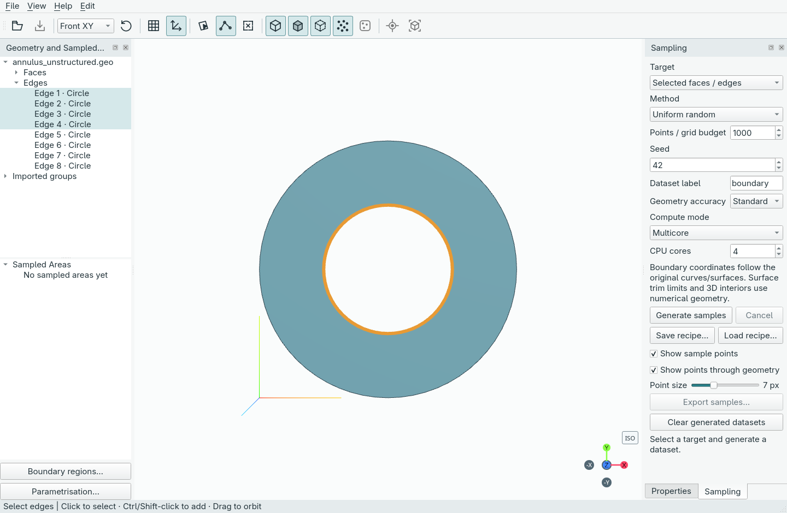

Click **Edges** in the toolbar (or press `E`), then select the four inner arcs.
Ctrl/Shift-click adds to the selection; the corresponding tree entries highlight.
You can select the edges in the tree too. The edge numbers in these pictures
belong to this particular annulus; inspect other models before choosing theirs.

#### 2. Name a boundary region

Click **Boundary regions…** below the left-hand trees. Enter `inner` as the
**Region label**, confirm that **Edges** is selected and the four inner arcs are
checked, then click **Save region** and **Close**.

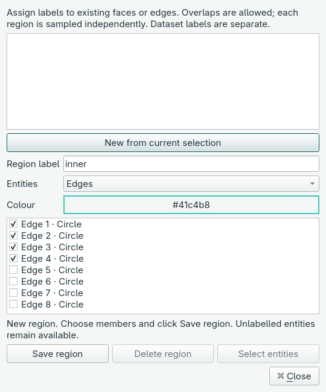

A region groups existing faces or edges under a name. It does not cut the CAD or
assign a physical boundary-condition value. Dataset labels are separate: they
name the generated point clouds.

#### 3. Generate boundary points

In the right-hand **Sampling** pane:

1. Choose **Target → Region: inner**.
2. Choose **Method → Sobol**.
3. Set **Points / grid budget** to **128** and **Seed** to **42**.
4. Enter `inner` as the **Dataset label**, then click **Generate samples**.

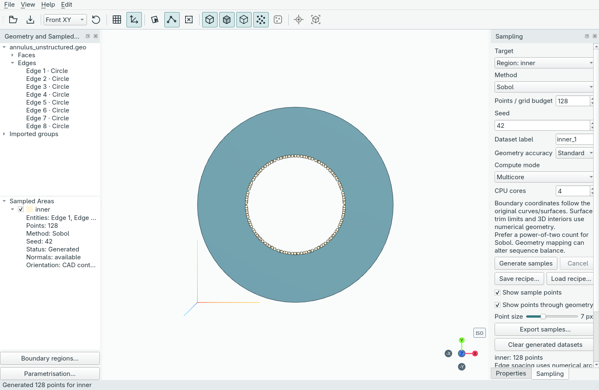

The new `inner` dataset appears under **Sampled Areas**, with its point count,
method, seed and normal availability. Its checkbox controls visibility. The
label field advances to the next available name after generation; it does not
rename the dataset you just created.

#### 4. Add interior points and inspect both datasets

Change **Target** to **Domain interior**, set the count to **512**, enter
`interior` as the label and click **Generate samples** again. The boundary points
remain, and a separate cloud fills the annulus without filling its hole.

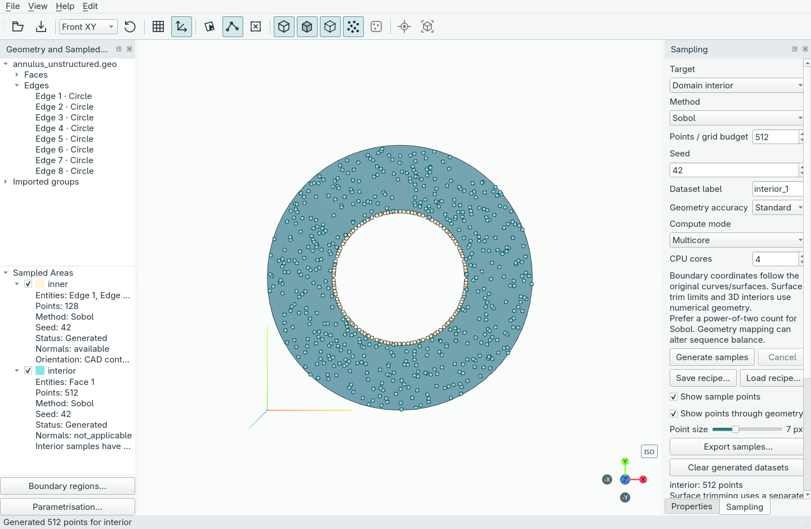

Use the dataset checkboxes to compare clouds, and **Point size** to adjust their
markers. Left-drag orbits, right-drag pans and scrolling zooms. Right-click a
dataset for editing, duplication or deletion; **Edit → Undo** restores supported
edits. Boundary normals are shown as available when their orientation was checked;
interior samples have no outward boundary normal.

#### 5. Save your workspace or export the points

Choose **File → Save project** (`Ctrl+S`) and save a `.jorvik` document to continue
editing later. Choose **File → Open project…** to reopen it. Projects preserve
geometry, regions, generated datasets and workspace settings.

Choose **Export samples…** in the Sampling pane, or **File → Export samples…**,
to save **NetCDF (.nc)** or **NumPy (.npz)** data for downstream work. All generated
datasets are exported, including clouds whose preview is hidden.

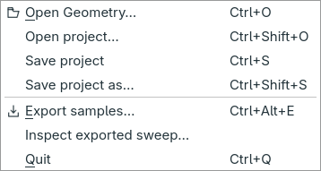

Save a project to keep an editable workspace; export samples to use the arrays
in another tool. Each label keeps its own point count. Neither operation requires
writing Python or running a terminal command.


#### 6. Reuse sampling settings

The Sampling pane's **Save recipe…** button saves the current target and settings
as a small JSON file. **Load recipe…** restores them for the same geometry. Check
the target, method, count and seed, then explicitly click **Generate samples**.
Loading a recipe does not run sampling or replace existing datasets.

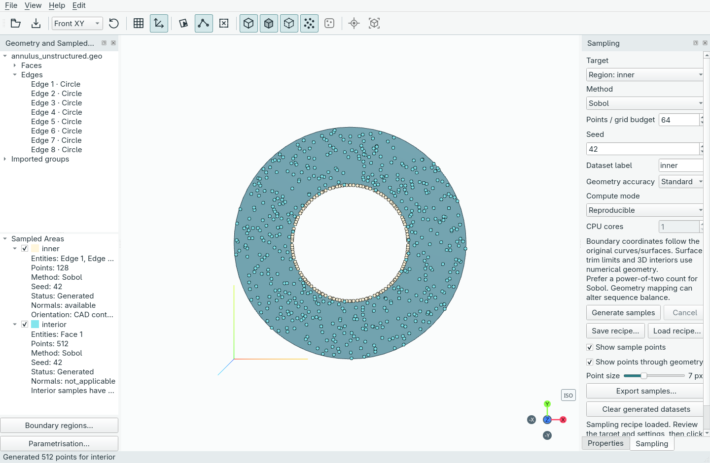

In this picture, the loaded recipe asks for **64** boundary points, while
**Sampled Areas** still shows the existing **128**. This is expected: the recipe
sets up the next generation. If its label is already in use, Generate creates a
new numbered label. Use **Edit → Undo/Redo** to undo or restore a recipe load.


## Desktop foundation

Drag with the left mouse button to orbit; right-drag to pan; scroll to zoom.
Use the camera selector or the bottom-right orientation gizmo for standard views.
The reference grid is hidden by default. Use Grid to show it in the XY plane
when needed. Grid and axes can be toggled independently.
Reset view returns to the default isometric camera; it fits the loaded geometry.

Left: Geometry and Sampled Areas. Right: Properties and Sampling. The left pane
contains independently scrollable geometry and sampled-area trees; drag their
divider to adjust their heights. Properties and Sampling scroll within their
panes when content grows. Selecting many entities keeps neighbouring panes
available. Properties text can be selected and copied. There is no bottom Results
pane; older saved layouts do not recreate it.
Use View to show/hide panes; drag their titles to rearrange or detach them.
View → Reset layout restores the initial layout. Window geometry, panel layout,
and theme persist between launches. Use File → Save project to preserve CAD, sampled datasets and workspace settings.

## Architecture

`geometry.py` runs Gmsh in a separate process, returning entity identities,
physical groups and per-entity display tessellation. Supported inputs are `.geo`,
STEP (`.step`, `.stp`), OCC BREP (`.brep`) and IGES (`.iges`, `.igs`). Geometry is retained in the source file; display triangles
are not a substitute for exact geometry in future sampling.

`src/jorvik/app.py` owns the Qt window, menus, docks and settings.
`viewport.py` embeds Qt WebEngine and exposes a small QWebChannel bridge.
`viewport3d/` contains local Three.js assets, OrbitControls and the orientation gizmo.
No CDN is required. Structural models, solvers, supports, loads and force diagrams
from PyniteGUI are excluded. Keep future CAD and sampling services independent of Qt.

## Agreed product scope

- CAD contains the faces/edges needed to distinguish boundary-condition regions.
- Users label one or more existing entities per region; labels are metadata.
- No CAD editing, boundary partitioning, BC-value assignment, or PDE solver.
- Sample interiors and individual boundary regions; include normals where applicable.
- Primary Python interface: xarray Dataset, persisted as NetCDF. Alternative: named
  NumPy arrays in NPZ. No Parquet. Exports use a versioned dataset schema.
- Preserve seeds, geometry references and sampling settings for reproducibility.
- Validate containment, surface distributions, normals, and labels before release.

## Development validation

```sh
uv run python -m unittest discover -s tests -v
uv build
```

The smoke test uses the real WebEngine viewport, checks renderer readiness,
camera changes, theme updates, dock persistence, and graphics errors. Run with a
desktop display; the test selects software rendering. Headless backend support
depends on the host graphics stack.
Check an interactive launch for orbit, zoom, pan, gizmo clicks and dock dragging.

## Documentation site

The documentation site uses [Zensical](https://zensical.org/docs/), installed only
through the optional `docs` dependency group. Preview it from a checkout:

```sh
uv sync --locked --group docs
uv run --group docs python scripts/sync_docs.py
uv run --group docs zensical serve
```

Open the local address printed by the preview command. To produce static HTML:

```sh
uv run --group docs python scripts/sync_docs.py --check
uv run --group docs zensical build --strict
```

The build writes ignored output to `site/`. The site uses local theme assets and
system fonts. The published URL is <https://praksharma.github.io/Jorvik/>, set as
`site_url` in `zensical.toml` so project-site links and canonical URLs include
`/Jorvik/`.

The top bar links to the GitHub repository beside search on wide screens. Zensical
fetches public GitHub star/fork counts in the browser; no extra plugin is needed.
These settings in `zensical.toml` enable the repository header:

```toml
[project]
repo_url = "https://github.com/praksharma/Jorvik"
repo_name = "praksharma/Jorvik"
```

Counts need access to GitHub's API and may be unavailable offline or when rate
limited. The repository link still works independently of the counts.

In GitHub Settings → Pages, select **GitHub Actions** as the source. The
Documentation workflow checks canonical pages and performs a clean, strict
Zensical build. Pull requests are checked without deploying. Matching pushes to
`main`, or a manual workflow run on `main`, upload the generated `site/` artifact
and deploy it through the `github-pages` environment. Publication must upload
`site/`, not raw `docs/` Markdown: GitHub's default Markdown/Jekyll rendering does
not apply the Zensical theme. After pushing, check both the build and deploy jobs
in Actions; changing the Pages source alone does not publish a Zensical build.

Keep detailed workflows, architecture, limitations and test instructions in this
`GUIDE.md`. Edit `TODO.md` for the roadmap and `THIRD_PARTY.md` for attribution.
`scripts/sync_docs.py` creates the corresponding committed pages under `docs/`;
do not edit those generated pages directly. Add new guide headings to the script's
page map so every section remains visible. The check fails on missing, stale or
unmapped content. Edit `docs/index.md` for the landing page.

Screenshots live in `docs/assets/screenshots`. Their canonical links in this
GUIDE start with `docs/assets/`; the sync script rewrites them for generated topic
pages. To refresh the real GUI captures with an isolated annulus session on a
machine with a desktop display, run `uv run python scripts/capture_docs.py`.
Review each image for legibility and correct state before committing it.

When documenting a new workflow or public API, include a minimal command or Python
snippet with its required inputs, output shape/files and relevant failure behaviour.
For GUI workflows, lead with actual app screenshots and labelled click-by-click
steps. Keep Python/command examples in the integration reference. Keep examples
aligned with the implemented interface, identify snippets that share
session variables, and run them against a small fixture before publishing. Extend
**Practical recipes** for end-to-end examples; keep detailed limitations on the
topic pages. Refresh landing-page feature claims alongside guide updates.

## Provenance

See THIRD_PARTY.md for the source revision and retained licences. roadmap.txt is
the original planning reference; README, this guide and TODO describe current scope.

## Foundation validation record

Validated on 2026-10-10 with Python 3.12 and PySide6 6.12: real WebEngine
startup, camera/bridge response, pane visibility and persistence, and theme
settings passed on Wayland using software rendering. The initial window was
visually inspected. Source and wheel distributions built successfully. This host
emits graphics-driver warnings; its offscreen and X11 paths were not usable.
Interactive mouse gestures and other operating systems still need manual checks.

## Geometry import and selection

Open a supported geometry file with File → Open Geometry, or pass its path on the command
line. Import runs outside the UI process; a failed import retains the previous
model. Closing the window stops an active import. File replacement clears old
selections. Face and edge IDs are scoped to the loaded document.

Select faces (F) uses a crosshair cursor; Select edges (E) uses a cell cursor.
Switching modes clears selection. Click selects one entity; Ctrl/Shift-click
toggles additional entities; clicking empty space or Esc clears selection.
Dragging orbits without selecting. The geometry tree can also select entities
and automatically switches to their face/edge mode. Properties shows IDs,
geometry types and imported physical group IDs. Imported groups are read-only.

Hover is teal; selection is orange. Edge hover uses a 4-pixel stroke and
selected edges use a 6-pixel stroke, maintaining their screen width while
zooming. Ordinary edges remain thin. Surface triangles map to original faces;
only original geometry edges participate in edge selection. Edges hidden behind
nearer visible faces cannot be picked. Edge picking uses a fixed six-pixel
screen-space radius with depth tested at the nearest candidate edge point.
Boundary region editing and face hide/isolate controls are available below.
Sampling is available through the Sampling tab; its numerical mesh is separate
from the display tessellation.

Display tessellation follows the source geometry's surface meshing settings;
coarse inputs may look faceted. It is not a sampling accuracy guarantee.

Validation includes asynchronous import of both reference files, face clicks,
annulus hole rejection, edge clicks and multi-selection, tree synchronization,
file replacement, import failure preservation, and drag suppression. The real
Qt WebEngine renderer and QWebChannel bridge are exercised on Wayland.

## NVIDIA rendering on Linux/Wayland

Normal launches automatically apply the NVIDIA workaround inherited from
PyniteGUI when one NVIDIA GPU drives the connected display: Qt Vulkan backend,
NVIDIA EGL/Vulkan driver selection, and exclusion of Mesa Vulkan layers. These
settings apply only to this application process and respect existing graphics
environment overrides. Do not pass `--software-rendering` for GPU rendering.

PySide6 is now pinned to 6.12.0 for shared-environment compatibility. An earlier
Quadro RTX 4000 check found a Qt 6.12 startup stall and used 6.11.2 successfully.
On 29 October 2026, automatic rendering was verified with Python 3.14.8 and
PySide6 6.12.0 on the current Linux/Wayland host: the live WebGL context reported
`ANGLE (NVIDIA Corporation, NVIDIA GeForce RTX 3060 Laptop GPU/PCIe/SSE2, OpenGL ES 3.2)`
with no lost context. This does not establish Qt 6.12 behaviour on the earlier
Quadro system. Check Help → Graphics information for the observed renderer;
`--software-rendering` remains available when a host's graphics setup needs it.

Close the main window or use File → Quit (`Ctrl+Q`). Terminal `Ctrl+C` (SIGINT)
and SIGTERM are routed through the same close workflow rather than raising
`KeyboardInterrupt` inside a Qt callback. Unsaved changes still offer
Save/Discard/Cancel. When a project file operation is in progress, closing waits
for it to finish and retries automatically; it does not interrupt an atomic save.
The `qt.qpa.wayland: EGL not available` warning alone does not mean shutdown failed.
Process-level tests check terminal signals and normal close, with separate UI
checks for deferred closing and cancelled unsaved-change prompts.

## Sampling

The right dock contains Properties and Sampling tabs. Choose a target:
selected faces/edges (Ctrl/Shift-click for multiple entities), Domain interior,
an imported physical face/edge group, or a saved boundary region. Point count is the total across that
target, not a count per constituent entity. Each dataset has a unique label.
After successful generation, the label field automatically suggests the next
available numbered name: `boundary`, `boundary_1`, `boundary_2`, and so on.
Existing names are skipped; manually reusing a name also selects an available
numbered variant. You can enter a different base name at any time. Failed or
cancelled generation does not advance the suggested name. Each generation adds
a separate dataset and preserves earlier coordinates and entity tags. Sampled Areas
lists the generated datasets with their source entities.

Methods implemented:

| Method | Candidate design |
| --- | --- |
| Uniform random | Independent pseudorandom unit-cube coordinates |
| Regular grid | Complete Cartesian lattices or evenly spaced curve positions |
| LHS | SciPy Latin hypercube |
| Sobol | Scrambled SciPy Sobol, generated in power-of-two blocks |
| Halton | Scrambled SciPy Halton |
| Hammersley | Finite Hammersley set with a seeded random shift |
| Stratified | One random point per recursively partitioned equal-volume stratum |

The seed reproduces the candidate design for a fixed source, method, accuracy
and software version. Regular grid is deterministic and does not use the seed.
Sobol is strongest at power-of-two counts; truncation, geometric transformation
and rejection can change its balance properties. Likewise, final samples on an
irregular domain do not necessarily retain Cartesian LHS or stratification.
These coverage properties apply to the candidate space. See the
[SciPy QMC documentation](https://docs.scipy.org/doc/scipy/reference/stats.qmc.html).

### Sampling recipe files

Use **Save recipe…** and **Load recipe…** in the Sampling pane to reuse settings
without keeping generated point arrays in the recipe. This is separate from
**Save project**, which preserves the full editable workspace and existing data.
No Python or command is needed for the recipe workflow.

1. Open geometry and select a target: chosen faces/edges, an imported group, a
   saved boundary region or **Domain interior**.
2. Choose the method, point count/grid budget, seed, dataset label, geometry
   accuracy, compute mode and CPU count.
3. Click **Save recipe…** and choose a JSON filename, for example
   `inner.sampling.json`. Saving does not generate points or change the controls.
4. Later, open the original geometry or saved project and click **Load recipe…**.
5. Review the restored controls, then click **Generate samples** explicitly.


A recipe records the main source hash, format/import settings, original entity
references and sampling settings. It contains no CAD source, generated coordinates,
tags or normals. Moving/reopening identical CAD is supported; the recipe binds to
the newly loaded document. Changed source hashes, import settings or missing
entities are rejected before any controls or selection change. Hashes cover the
main file, not the entire external dependency graph of a `.geo` script.

Boundary-region recipes require the same region label and exact membership in
the current project. Region IDs can change between documents; membership is not
inferred or remapped. Imported-group recipes likewise require the same dimension
and member tags. A recipe does not create or edit regions. Reopen the saved
project when its region definitions are needed.

Successful loading restores controls and, for selection targets, the face/edge
selection. Existing datasets remain unchanged; Generate uses a new numbered
label if the recipe's label is already in use. Loading is one undoable edit,
including its target, controls and selection. Saving a recipe is not an edit.
A grid recipe retains its original candidate budget, not a previously clipped
output's actual point count. Identical seeds do not promise identical coordinates
across changes in mesher/library versions or numerical geometry settings.

Recipes are validated against the current GUI/machine limits. For example, the
GUI accepts seeds through 2,147,483,647, Standard/Fine accuracy and the available
CPU range. A valid API recipe outside those limits is rejected atomically rather
than silently clamped. Reproducible recipes use one CPU thread. Recipe actions
are disabled during processing or without geometry. Older projects without import
provenance need their original CAD reopened before creating a recipe.


### Geometry and accuracy

Curve coordinates are evaluated on the original Gmsh curves. Numerical
arc-length inversion distributes samples by length across the selected edges.
Surface coordinates are evaluated on the original Gmsh surfaces, with derivative
Jacobian weighting and rejection to account for varying area in parameter space.
The trimmed parameter domain is represented by a separate surface tessellation;
curved trim boundaries consequently have numerical tolerance. Planar face
candidates are also checked using Gmsh containment, including the annulus hole.
The Jacobian rejection envelope is estimated numerically with a safety margin;
generation fails if a candidate exceeds it. This is not a certified global bound.

3D interiors use a separate tetrahedral mesh and volume-weighted barycentric
sampling. Curved-domain approximation depends on mesh accuracy; this is not an
exact CAD solid containment guarantee for arbitrary concave shapes. Standard
and Fine cap the sampling mesh size at the geometry's largest bounding-box
extent divided by 32 and 64 respectively. This is independent of viewport
triangles. Compare accuracy levels before using unfamiliar curved domains for
scientific training. Surface parameter grids have regular parameter spacing,
not necessarily constant spacing measured on the curved surface.

Regular grid clips a complete grid to the target; actual counts can be lower
than the budget. Multi-face grids divide the budget equally between faces.
Other methods return the requested count. Curves use a length-weighted entity
allocation; random surface and volume sampling are area/volume weighted.

### Boundary normals

Boundary sampling evaluates derivatives on the original geometry and returns
finite unit `normals` when every point's outward orientation can be checked.
Faces bounding exactly one solid receive `outward_surface` normals. Edges
bounding one planar face receive in-plane `outward_conormal` vectors; hole
boundaries point into the hole. Interior samples and 3D edges have no unique
outward boundary normal. Open faces and shared interfaces do not receive guessed
orientations. If a derivative, parent domain or containment check is ambiguous,
the whole dataset omits normals and records `normal_status` and `normal_note`.
Properties and Sampled Areas show this availability.

Orientation probes test both sides of each evaluated normal using parent-domain
containment. Built-in volumes use a separate tetrahedral mesh because Gmsh does
not implement direct volume containment for that kernel. Probe distances range
from 1e-6 to 1e-2 of the parent extent to account for CAD/mesh tolerances; the first
unambiguous result determines the sign. These are numerical checks, not a proof
for arbitrary thin or invalid CAD. Broader containment validation and certified
sampling bounds remain open release work. Normals do not alter point coordinates.

Export schema **2** stores each available normal array under the manifest's
`normals` key, with shape `(point, xyz)` alongside its coordinate array. In xarray,
use `ds[ds[label].attrs['normals_coordinate']]`; in NPZ, load the key named by the
region manifest. `normal_kind`, `normal_status` and `normal_validation` remain
in metadata; numeric normals are not repeated in JSON. Project schema **2** also
stores normals as numeric arrays and continues to read schema-1 projects.
New planar edge datasets also store `normal_planes` in metadata: one unit parent
plane normal per sampled edge tag, with string tag keys. This compact direction
map enables correct co-normal transport after non-uniform scaling. It is optional
for legacy datasets; malformed supplied frames are rejected when exporting or
restoring a project.
Malformed, non-finite, non-unit or missing advertised normal arrays are rejected.

### Previews and generation lifecycle

Points use circular markers with dark outlines, starting with warm white for
visibility against selected orange faces and under Night Light. Further datasets
use contrasting colours. The Point size slider changes the marker diameter
(3–16 screen pixels, default 7) immediately without regenerating coordinates;
its value is remembered between sessions. The Sampling pane scrolls when space
is limited so controls retain their natural height. Show sample points toggles the
preview; Show points through geometry reveals interior samples. Clear generated
datasets removes all in-memory datasets. Samples are generated in a separate
process, with cancellation; errors retain previous datasets. Geometry replacement
clears datasets. If the source geometry file changes, reopen it before sampling.
Metadata includes source SHA-256, target entities, method, seed, requested/actual
counts, accuracy and approximation notes. Export saves the current datasets;
full projects preserve application configurations, samples and applicable normals.

Validation covers all methods on curves, 2D and 3D interiors; reproducibility;
unit-design properties; annulus containment and area coverage; sphere surface
membership, face membership and area coverage; changed-source rejection; and
GUI generation, preview clearing and cancellation.


## Exporting samples

Use **Export samples…** in Sampling, or **File → Export samples…**
(Ctrl+Alt+E). It exports all generated datasets, including hidden point previews.
NetCDF (`.nc`) is the default; NumPy archive (`.npz`) is the alternative.
The controls become available after generation and are disabled while sampling.
Cancelling the save dialog leaves datasets untouched. Writes use a temporary file
in the destination folder and replace the destination only after a complete write;
a failed save preserves an existing file.

### Schema version 2

Each label is one float64 coordinate array of shape `(N, 3)`, in `x, y, z` order.
Different labels have independent point dimensions (`_gs_points_0`, etc.), so
unequal point counts never produce padding or NaNs. Entity tags are int32 arrays
with one tag per point. Coordinates retain source geometry units; the importer
does not currently identify or convert those units. Applicable normals are
exported as separate numeric arrays. Export is a data snapshot, not a saved editable application project.

Common identifier labels such as `boundary`, `boundary_1`, and `interior` are
array names in both formats. Labels containing spaces, punctuation or Unicode,
reserved names (`xyz`, `file`, `allow_pickle`, `like`), and names starting `_gs_`
use internal `_gs_region_N` names. Original labels are preserved in metadata.
The `_gs_` prefix is reserved for dimensions, entity-tag arrays and metadata.
No user label is silently lost or changed in the metadata.

The xarray interface is `jorvik.export.to_xarray(batches)`. NetCDF is written
through xarray's SciPy engine as NetCDF3 64-bit offset, using the existing SciPy
dependency. The Dataset has only coordinate arrays as data variables; `xyz` and
`_gs_entity_tags_N` and optional `_gs_normals_N` arrays are coordinates. Per-variable attributes include `label`,
`method`, `seed`, `entity_dimension`, `entity_tags_coordinate`, and
`metadata_json`. The latter preserves all generation metadata, including target
entities, source path/SHA-256, document identity, requested/actual counts,
accuracy and approximation notes. Global `metadata_json` contains the ordered
label-to-array map, schema/app versions and source-unit description.

```python
import json
import xarray as xr

with xr.open_dataset('samples.nc', engine='scipy') as ds:
    points = ds['boundary'].values  # (N, 3)
    tags = ds['boundary'].coords[ds['boundary'].attrs['entity_tags_coordinate']].values
    metadata = json.loads(ds['boundary'].attrs['metadata_json'])
```

NPZ uses the same coordinate array names, plus `xyz`, `_gs_entity_tags_N`,
optional `_gs_normals_N`, and
`_gs_metadata` (a Unicode scalar containing JSON). It contains no Python objects
and loads with `allow_pickle=False`. Its manifest maps each original label to
its coordinate and entity-tag array names and retains generation metadata.

```python
import json
import numpy as np

with np.load('samples.npz', allow_pickle=False) as data:
    points = data['boundary']  # (N, 3)
    manifest = json.loads(data['_gs_metadata'].item())
    by_label = {item['label']: item for item in manifest['datasets']}
    tags = data[by_label['boundary']['entity_tags']]
```

Validation covers unequal array lengths, exact coordinate/tag round trips,
Unicode/reserved labels, invalid data, preservation of existing files on save
failure, and both export options from the actual sampled-face UI workflow.


## Sampled Areas tree

The lower part of the left pane replaces the former bottom Results dock. Each
label expands to Entities, Points, Method, Seed and Status. Generated point
counts include thousands separators. Check a generated label to show its points;
uncheck it to hide only that dataset. The global Show sample points control
still hides all previews and preserves individual visibility choices when turned
back on. Point-size and through-geometry settings respect those choices too.
Export always includes all generated datasets, even hidden ones.

Selecting a label or one of its detail rows shows its metadata and approximation
notes in Properties. This does not change the active CAD entity selection or
sampling settings. A running request appears with status Generating; a cancelled
or failed request remains as Not generated, with no visibility checkbox or
exported coordinates. These entries represent attempted runs, not saved region
configurations. Clear generated datasets clears the tree, including unfinished
attempts; replacing geometry clears it as well.


## Toolbar and visibility

The viewport tools use theme-aware icons and hover tooltips. Separators group
file operations, camera controls, grid/axes aids, selection, visibility and region
isolation. Open/export are also available in File; visibility actions have named
entries under View → Visibility. The camera orientation dropdown retains view
names so each direction remains explicit. Keyboard shortcuts remain available.

Geometry is the master visibility switch. Faces and Edges independently control
shading and wireframe; hiding Faces retains enabled edges. Hiding Geometry hides
both while remembering the separate Face/Edge choices. Hidden CAD entities cannot
be picked in the viewport; the geometry tree still allows their selection.
Visibility toggles do not clear the existing selection.

All samples mirrors Show sample points in Sampling. Selected region samples
mirrors the checkbox of the currently selected generated Sampled Areas label.
Both controls preserve the coordinates and export data.

Select a generated label and toggle Isolate region to filter the viewport to that
label's sample points. Isolation initially hides geometry; Geometry in isolation
optionally shows the region's faces and their boundary edges (or its sampled
edges). For domain-interior samples, the geometry context is the whole domain,
because interior generation currently targets all volumes. Global visibility
switches and region checkboxes still apply during isolation. Selecting another
generated label changes the isolation target. Turning isolation off restores the
normal visibility choices without changing them. Clearing datasets or replacing
the geometry exits isolation. These controls affect only display: geometry,
selection, sampling settings and generated coordinates are retained, and export
includes hidden and non-isolated datasets.


## Sampling performance and CPU modes

Sampling remains isolated from Qt in a cancellable background process. It now
starts in **Multicore** mode in the GUI, with up to four CPU cores by default
(capped by the process's available CPUs). The CPU cores control sets the maximum
Gmsh meshing thread count. Curves/surfaces can mesh in parallel across entities;
3D interiors use Gmsh's parallel HXT tetrahedral mesher. Some geometry queries,
trimming/grid clipping and candidate-generation steps remain serial. This is
multithreaded native meshing inside one background process, not several GUI
processes. Source meshing options that affect geometry sizing remain in effect.

**Reproducible** mode uses one meshing thread, the source geometry's original
mesher, and the existing fixed meshing seed. It preserves the previous sampling
pipeline's coordinates on the tested fixtures. The Qt-independent API defaults
to this mode when `compute_mode` is omitted. Multicore meshing can produce a
different numerical mesh and coordinates across runs or core counts, even with
the same sampling seed. Gmsh's experimental reproducible-mesh option is enabled
in Multicore mode, but exact repeatability is not promised. Export metadata
records `compute_mode`, `cpu_threads`, `mesh_algorithm_2d`, and
`mesh_algorithm_3d`, in addition to the seed and resolution. For 2D/edge sampling,
the recorded 3D algorithm is a model setting, not an algorithm used by that run.

Volume connectivity preparation now uses NumPy lookup arrays instead of Python
loops over every tetrahedron. SciPy's sequence generators are loaded only for
LHS, Sobol or Halton, reducing fresh-worker startup for the other methods. No GPU
sampling or Numba dependency is introduced; the profiled bottleneck was CPU
geometry meshing. The NVIDIA GPU continues rendering the viewport.

Measured on the development machine, for 1,000 Uniform random sphere samples:

| Case | Earlier pipeline | Current Multicore, 4 cores |
| --- | --- | --- |
| One face, Standard | 1.12 s fresh worker | 0.30 s fresh worker |
| Interior, Standard | 7.54 s calculation in the initial test | 1.01 s fresh worker |
| Interior, Fine | 68.07 s profiled calculation (64.19 s meshing) | 3.74 s fresh worker |

The timing columns use different instrumentation for the initial investigation;
they describe observed latency, not a controlled scaling experiment. A direct
fresh-worker comparison of the final modes gave 7.30 s Reproducible versus 1.01 s
Multicore for Standard interior sampling. Speeds depend on source sizing,
geometry, core count and method. Rendering/result display time is excluded.
Reproduce the complete fresh-worker comparison with:

```sh
uv run python tools/benchmark_sampling.py \
  examples/geometries/cfdbench/sphere_unstructured.geo --mode both --cores 4
```

Use `--face 6` for boundary sampling or `--resolution 64` for Fine interior.
The benchmark includes imports, meshing, sampling and JSON result transfer.
Validation covers multicore HXT interior membership and methods, serial fixture
reproducibility, unchanged saved baseline coordinates/tags, and GUI generation,
cancellation, visibility and export with the default Multicore mode.

### Undo, redo and dataset editing

The Edit menu provides **Undo** (`Ctrl+Z`) and **Redo** (`Ctrl+Shift+Z` or
`Ctrl+Y`). Session history retains the last 30 edits: sampling generation and
regeneration (including cancelled/failed recipe entries), dataset renaming and
colour changes, duplication, deletion, clearing datasets, saved boundary-region
edits, sampling-recipe loads (including controls/selection), and transform-setup
changes when closing the parametrisation workspace.
Undo restores affected dataset visibility, selection/isolation and parameter
bindings. New edits after undo discard the redo branch. Saving keeps history;
undoing back to saved content clears the unsaved-change state.

Right-click a sampled dataset and choose **Duplicate dataset** to create a
uniquely named copy, or **Delete dataset** to remove just that entry. Duplication
shares immutable coordinate/tag/normal storage while keeping metadata separate;
it does not resample the CAD. Delete and Clear generated datasets are undoable.
Deleting the last region bound by a transform setup clears that setup; undo
restores it together with its datasets.

History is local to the open document and is not stored in `.jorvik` archives.
Opening geometry or a project starts fresh history. Undo/redo is unavailable
during import, generation, project I/O and region/parametrisation dialogs. Camera
navigation, ordinary visibility changes, standalone sampling-control edits and
unsaved dialog fields are not separate history entries. Numeric point buffers
are shared between history snapshots, but retaining older generated datasets can
still use memory until their history entries expire or the document is replaced.

## Face and sampled-area context menus

Right-click a face in the geometry tree to hide the selected faces, isolate them,
or show all faces again. Right-clicking an unselected face selects it; right-clicking
one of several selected faces keeps the group. These controls affect shaded faces;
edges retain their separate visibility setting. Picking uses the nearest visible face at the cursor. Edge picking uses a fixed
six-pixel radius at every zoom level and tests occlusion at the candidate edge
point; an edge behind a visible face cannot be selected through it. The nearest
edge in screen distance wins, with camera depth breaking ties. Geometry outside
the camera clipping range is ineligible. Hidden faces cannot be picked in
3D, but remain available in the tree. Show all faces also restores the Geometry and
Faces switches and exits sampled-region isolation. Importing geometry clears face masks.

Right-click a Sampled Areas label (or its details) to rename it, change its colour,
show/hide its points, isolate it, or show all regions. Colour swatches match the point
clouds; defaults use warm white, cyan, lime, lavender and white. Changes take effect
immediately. Renaming requires a non-empty, unique label and is disabled during
generation. Hidden/isolation state and coordinates survive renaming. Exports use
the new labels and include each region's colour in its metadata. Canceling either
dialog leaves the region unchanged. These display choices are included when saving a project.

### User-defined boundary regions

Open geometry, select faces or edges, then click **Boundary regions…** below the
geometry tree. Use **New from current selection**, enter a non-empty region
label, choose a colour, check the desired entities and click **Save region**.
A region contains multiple faces or multiple edges; mixing dimensions in one
region is rejected. Labels support spaces, Unicode and slashes. Region labels
are unique among boundary definitions and are independent of dataset labels.
Selecting an existing region lets you rename it, change membership/colour,
select its saved entities in the viewport, or delete its assignment. Closing the
editor discards unsaved form edits; saved edits take effect immediately.

Regions are metadata on prepared CAD, not geometry partitions or physics values.
An entity can belong to several regions. Each region samples independently, so
overlapping regions may yield overlapping point clouds; no deduplication or
single-owner rule is implied. Shared entities display the first-created region's
colour, with hover/selection highlights taking precedence. Unlabelled entities
remain selectable and can be sampled through the normal selection target.

Choose **Region: <label>** in Sampling to generate from its current members.
Each generated dataset stores an immutable `boundary_region` snapshot with the
region's identifier, label, colour, members, document, source format and source
hash. Renaming/deleting a definition does not rename a dataset or change its
existing samples/provenance. Editing a sampled area's recipe manually makes it
an explicit selection target instead of silently retaining an obsolete binding.
NetCDF and NPZ metadata preserve the snapshot.

Full projects preserve region definitions and the chosen region sampling target,
including when the original CAD file has moved. Hash checks reject changed source
files before sampling or project saving; loaded assignments must reference the
saved document and valid entities. A successful new geometry import clears region
assignments rather than guessing that numeric tags still identify the same CAD.
Failed imports preserve the current assignments and datasets. Legacy projects
without boundary definitions open with an empty list.

### Parametrisation: transform configuration

Generate boundary/interior samples, then click **Parametrisation…** below
Sampled Areas. The Parameters tab supports one configuration with translation,
axis-angle rotation, positive uniform/non-uniform scaling and a shared pivot.
Use equal X/Y/Z scale factors for uniform scaling. Axis vectors are normalized;
the UI takes angles in degrees, while saved setup files also support radians.
Scale factors must lie between 1e-8 and 1e8; zero, negative and non-finite values
are rejected. The UI rejects setup values outside its range or precision before
changing any controls.

The order is fixed and recorded: **scale → rotate → translate**, using world
coordinates. Both scale and rotation use the supplied pivot in source geometry
units; scale factors are dimensionless. A point is mapped as
`p' = pivot + R × S × (p - pivot) + translation`. Every preview and export starts
from original coordinates. This maps the prepared geometry and point sets; it
is not CAD dimensional regeneration or a resampling operation.

**Whole domain** maps the geometry display and every sampled cloud together.
**Selected regions** maps only checked point clouds and leaves CAD fixed; its
boundary/interior consistency is explicitly unverified. Labels, original CAD,
sampling recipes, point counts, entity tags, region assignments, colours and
visibility are retained. Applicable existing surface normals follow the normalized inverse transpose of
the linear map. Positive scaling preserves orientation; translation leaves
normals unchanged. New planar boundary samples retain a `normal_planes` metadata
map from sampled edge tags (string keys) to unit parent-plane normals. Co-normals
are transformed using their in-plane tangent and inverse-transpose plane normal,
remaining outward and within the transformed plane under non-uniform scaling.
Plane frames follow rotations/scaling and persist in projects, NetCDF and NPZ.

Older datasets without plane frames still support rotation and uniform scaling;
non-uniform scaling omits their co-normal arrays and marks them unavailable.
Regenerate those samples from the original CAD to retain plane frames. No normals
are invented for open shells or datasets whose normals were unavailable. Invalid
frames, missing edge mappings or co-normals outside their plane are rejected.

Scaling changes point density per unit length/area/volume, and non-uniform
scaling can change relative surface density. Exports contain transformed points,
not Jacobian/integration weights, so downstream integrations need their own
measure treatment. No point count adjustment or automatic resampling is applied.

Parameter edits only mark the preview stale. Click **Preview configuration**
explicitly to update, or process/export directly. Restore, Close and Escape
remove the preview without accumulating transforms; the original datasets remain
intact. Opening geometry or editing original data is disabled while the workspace
is open. Hidden/unaffected regions are included in exports.

Save/load a lightweight JSON setup containing scope, source geometry hash,
region labels and transform values. New setups use parametrisation schema **2**
with axis, angle/units, scale, pivot, order and frame. Legacy schema **1**
translation setups still load with identity rotation/scaling. These schema
versions are independent of the ordinary dataset and project archive schemas.
Projects retain the complete setup, and session undo/redo can restore setup edits.
Loading rejects changed geometry, missing labels or invalid transforms atomically.
**Reset setup** restores the original view and identity values: zero translation
and angle, Z rotation axis, unit scale, zero pivot, whole domain and no bindings.
Restore original view removes only the preview and retains configured values.

Each NetCDF/NPZ export retains all datasets with their independent point counts,
source/sampling metadata and transform provenance. `_gs_translation` and its
`_gs_parameter` labels remain available. Schema 2 also writes
`_gs_transform_matrix` as a 4×4 row/column affine matrix, `_gs_scale`, `_gs_pivot`,
`_gs_rotation_axis` and `_gs_rotation_angle`. The global JSON manifest retains
the full setup and configuration count; each dataset records whether it was
affected, the transform matrix/order/frame and the density limitation. NPZ uses
`allow_pickle=False`; writes preserve existing destinations on failure. The
NetCDF backend remains NetCDF3.

#### Parameter designs and selected configurations

In **Combinations**, enable **Use a parameter design** and add named parameters.
Each name binds to exactly one translation component, rotation angle, individual
scale component or uniform scale. Uniform scale sets all three scale factors and
cannot overlap individual scale bindings. Values assign the target absolutely;
the reference value is descriptive metadata, not an offset or normalization.
Rotation uses the base angle units, distances use the unspecified source units,
and scales are dimensionless. No physical unit conversion is inferred.

For **Cartesian product**, each parameter supplies an inclusive range/value count
or an explicit comma-separated list; the first parameter changes slowest. For
**Paired values**, all lists/counts must have the same length and values are paired
by position. One-point ranges use their start value. **Seeded random**, **LHS** and
**Sobol** use parameter ranges plus a separate total configuration count and seed.
Those seeds/designs are independent of spatial sampling methods and seeds. Sobol
balance is strongest at power-of-two sizes; other sizes truncate a larger balanced
sequence. Exact numeric sequences can change with scientific-library versions;
the exported actual parameter values are the record of what was applied.

The summary shows configurations, points per region/configuration, total points
and an estimated uncompressed numeric payload before generation. Estimates cover
coordinates/tags/available normals; metadata/container overhead and compression
are excluded. At most 10,000 configurations are allowed, and oversized Cartesian
products are rejected before allocating the grid. Scalar configurations are
paged in sets of 200 rows. Literal, case-insensitive search matches configuration
IDs, parameter names and numeric values, retaining the original IDs and row order.
No matches disables selected-row actions. Clearing search restores the full table;
search does not change the design or its generated values. Generating this table
does not create transformed point clouds or regenerate spatial samples.

Click **Generate configurations**, select a row, then **Preview selected
configuration** or **Export selected configuration**. The Processing/Export tabs
also use the selected row when the design is enabled. Selection alone never
changes the viewport. Edits to base transforms or design definitions invalidate
the table and require explicit regeneration; the old viewport preview stays
visible until Preview/Restore. Invalid transform configurations fail generation explicitly with their ID.
Optional named constraints reject candidates with a visible reason report, without
replacement or renumbering.

Exports still contain **one** selected configuration and every original dataset
with its independent point count. `_gs_design_parameter`, `_gs_design_values`
and `_gs_design_units` record the named values once as aligned arrays. Metadata
retains stable IDs (`configuration_000001`, ...), algorithm, seed, target bindings,
units and actual values. The complete design definition is retained once in the
global manifest; long explicit lists are not copied into every generated row or
region. Setups/projects retain nested design schema **1** inside transform schema
**2**. Reopening restores definitions but requires Generate configurations again;
the generated table and preview are not saved. Invalid unfinished design drafts
are discarded on close with a status message, retaining the last valid setup and
unlocking the workspace.

#### Parameter constraints and rejection reports

In Combinations, optional literal rules compare a named parameter to a constant
or another parameter with the same units. Supported comparisons are `<=`, `<`,
`>=`, `>`, `==` and `!=`. All rules must pass. Up to 32 uniquely named rules are
allowed. Constants inherit the left parameter's units; parameter names are literal
keys, so spaces and Unicode are supported. No expression evaluation is performed.
Comparisons use exact floating-point values, including equality; no tolerance,
clamping or automatic value changes are applied.

Generation reports accepted and rejected counts. **Rejected configurations…**
shows the original IDs, actual named values and every failed rule, with literal
search and 200 entries per page. Candidate IDs are assigned before filtering:
accepted rows can have gaps. No replacement draws are made. Filtering can destroy
LHS strata, Sobol balance and uniform coverage; retained samples are not claimed
to be a fresh balanced design. Estimates before generation are upper bounds for
all candidates. An all-rejected design cannot be previewed or exported.

Definitions persist in setup JSON and projects. Selected-file provenance carries
the rules; sweeps store one checksummed `rejections.json` report plus
`design_filter` counts and coverage notes in the run manifest. Rejected rows are
excluded from processing and shown separately from failed/pending files in the
sweep inspector. Resume/retry requires the same rules and accepted ordered plan.
These are parameter comparisons, not CAD validity, containment or physics checks.


#### Background sweep export

After generating a current design in Combinations, open **Processing** and choose
**Export generated design…**. It exports **all generated configurations**, even
if the table search shows only a few matches. This is independent of the selected
row. Choose NetCDF (`.nc`, the default) or compressed NumPy (`.npz`) files and
**Stop at the first failed configuration** or **Continue and record failures**.
Select a new output-folder name; existing files and folders are never reused.

A single background worker reads the original datasets and transforms/writes one
configuration at a time. The viewport and original samples stay unchanged; no
full collection of transformed clouds is held in RAM. Parameter/design-definition
editing and other exports are disabled during work. Progress shows attempted,
written and failed counts plus elapsed time. **Cancel export** finishes the current
atomic file, then stops before the next configuration. Closing the workspace or
application requests the same cancellation and waits before destroying the worker.
Completed outputs and partial-run records are retained.

The new folder contains:

- `manifest.json`: sweep schema **1**, source hash, original dataset recipes,
  full base/design definition, format, counters, elapsed time and final status.
- `configurations.json`: scalar configuration IDs, actual named values, transform
  setups and expected filenames; written once before data processing.
- `results.jsonl`: one result per attempted configuration, appended only after its
  export completes or fails. Successful entries name their output file; failed
  entries record an error and have no successful filename.
- `configuration_000001.nc` or `.npz`, etc.: independently loadable configuration
  files with original label maps, unequal region point counts, entity tags,
  applicable normals, actual parameter values and transform provenance.

`complete` with `all_outputs_complete: true` means every shard succeeded.
`complete_with_errors` means all configurations were attempted but some failed;
`failed` stops on an error; `cancelled` leaves remaining configurations pending.
An interrupted process may leave `running`, a missing manifest or an incomplete
last journal line; none indicates a complete run. **Resume/retry saved sweep…**
verifies a compatible saved run and continues into a new folder, copying verified
completed outputs and regenerating failed/pending configurations. Each shard and each manifest checkpoint
is written atomically. Original recipes, region seeds, methods and point counts
are retained; affine mapping does not regenerate CAD or improve spatial accuracy.

Use the validated readers below to consume successful configurations. They
check completion state, provenance and available checksums. For copyable setup,
design and export examples, see **Practical recipes** at the end of this guide.

#### Reading sweeps for training

`jorvik.sweep_results.inspect_sweep(path)` checks the run manifest, scalar plan,
result counters and completed-file presence without loading point arrays.
`iter_sweep_datasets(path)` then yields one completed configuration at a time,
validating each shard's source/setup/parameter provenance, shapes, finite values,
entity tags, label/count mapping and applicable unit normals. New sweeps record
SHA-256 hashes and byte counts for the scalar plan and each successful shard.
Inspection verifies the plan checksum; iteration verifies each shard checksum
before loading it, using bounded-memory reads. This detects changes even when
coordinate arrays remain structurally valid. Hashing adds a sequential file read
per export and per verified import.

Older sweeps remain readable with structural checks. Pass `require_integrity=True`
to either API to reject runs without checksums. A missing or malformed checksum
in a run that declares integrity is always an error. Checksums detect accidental
changes; they do not authenticate the author or protect against someone replacing
both files and their recorded hashes. Keep run files unchanged while reading.
Both APIs reject incomplete/error runs by default. Pass `allow_partial=True`
explicitly to use successful files from cancelled, failed or interrupted runs.
Only an interrupted `running` journal's malformed final unterminated line can
be ignored; malformed earlier records remain errors. Reading a run does not resume it.

```python
from jorvik.sweep_results import iter_sweep_datasets, training_arrays

for configuration in iter_sweep_datasets("parameter_sweep"):
    columns = ["x", "y", "z", *configuration["parameters"]]
    arrays = training_arrays(configuration)
    for label, inputs in arrays.items():
        # Each region has its own N×(3+P) array, with columns ordered as above.
        pass
    # Normals, entity tags and sampling metadata remain in configuration['datasets'].
```

Parameter columns are expanded only by `training_arrays`, leaving persisted
parameter values stored once per configuration. Boundary/interior datasets are
not merged, padded or assigned physical conditions. Readers close each file
before yielding independent arrays. Consume the iterator incrementally to bound
memory; converting it to a list intentionally retains all loaded configurations.

From a checkout, inspect a run without modifying it:

```sh
uv run python tools/inspect_sweep.py parameter_sweep --verify --require-integrity
# Explicit partial-output inspection:
uv run python tools/inspect_sweep.py parameter_sweep --allow-partial --verify
```

Size estimates concern numeric payloads, not peak Python/Qt memory or compressed
file size. Memory still scales with the original datasets and one transformed
configuration. Multiple concurrent workers, within-file cancellation, automatic
in-place resume, general expression constraints, NetCDF4 grouped output, Jacobian weights and CAD
regeneration remain later work. Continuation into a new folder is supported as
shown in the GUI walkthrough.

### Neutral CAD import

New imports and generated datasets record `source_hash`, `source_format` and
`import_options`: the Gmsh version, disabled user configuration loading, and
the loader used. STEP/BREP/IGES also record the explicit format and
`highest_dim_only=false` argument. These describe Jorvik's loader settings;
they do not claim to capture exporter settings or every option inside `.geo`
scripts. Project archives and NetCDF/NPZ metadata retain these records. Older
projects can omit import options; unknown historical settings are not inferred.

Generation rejects changed source content or a changed importer version/settings
when the original import record is available. Reopen the geometry to import it
again: this clears prior regions and datasets, so numeric entity IDs cannot
silently acquire old assignments. Automatic entity remapping and optional
healing remain future work. Main-file hashes do not cover external `.geo`
Include/Merge dependencies.

File → Open Geometry and the command line accept STEP, Open CASCADE BREP and
IGES alongside `.geo`. `cad_import.py` is the shared Qt-independent loader used
by both display and sampling workers. Neutral formats use Gmsh's OCC import and
synchronisation; scripts retain their original kernel. Available CAD entity names
appear in geometry-tree tooltips. Names are not automatically interpreted as BCs
or Gmsh physical groups, and face naming fidelity depends on the source exporter.

The backend model exposes `topology` separately from the face/edge display
`entities`. Each original vertex (dimension 0), edge (1), face (2) and solid (3)
has a document-scoped `(dimension, tag)` identity, CAD type/name, six coordinate
bounds, physical-group memberships, immediate `boundary` references and `upward`
adjacency references. Both adjacency lists contain `[dimension, tag]` pairs;
orientation is not encoded and must not be used to infer outward normals.
Construction vertices and degenerate edges remain in this model even if they
have no visible primitives. Topology contains no display triangles and is not an
editable or standalone exact-geometry representation; geometric evaluation still
uses the source CAD through Gmsh. Numeric tags are not stable across reimports.

Both built-in and Open CASCADE `.geo` scripts retain their kernels. Regression
checks construct the same cube in each kernel and verify original entity counts,
adjacency, physical groups and edge/face/interior sampling. STEP/BREP/IGES fixtures
also expose this topology. Projects preserve it and reject inconsistent entity
references, adjacency or bounds before replacing the workspace. Older projects
without topology remain readable; reopen the source to populate the new model.

Interior domains are explicitly classified as `solid`, `planar` or
`open_or_nonplanar`. A `.geo` file without volumes qualifies for 2D interior
sampling only when its faces are recognized analytic planes lying in one plane.
An open sphere, a non-planar shell or disconnected planes at different heights
cannot silently become a 2D interior dataset. Unsupported planar NURBS domains
are conservatively rejected until their planarity can be verified. Boundary
sampling remains available. Declared solid meshing failures identify open
boundaries/invalid topology instead of replacing existing sampled datasets.

Files containing faces but no solid volumes can be displayed and sampled on faces
and edges. Neutral-format interior sampling requires imported solid volumes and
reports a clear error for surface-only files. No automatic sewing is introduced
in this importer. This deliberately does not treat a set of cube-shaped surfaces
as a solid merely because it looks closed. Source units remain unspecified in
exports; unit detection/conversion, comprehensive assembly metadata and optional
healing remain roadmap work. Display topology retains zero-length CAD edges with
an explanatory tooltip, omits their rendering and rejects sampling them.

Try the downloaded fixtures under `examples/geometries/cad/`: `t20_data.step`
(a solid supporting interior sampling), `cylinder.brep` (curved solid),
`cube_filet.stp` (filleted surfaces with degenerate edges), and `cube1000.igs`
(surface-only cube). README, provenance.json and LICENSE.txt record pinned
upstream sources, checksums and licensing. They are not converted `.geo` files.

STEP/BREP/IGES support is validated on these small fixtures; industrial CAD,
assemblies, additional STEP application protocols, units, healing and stable
cross-import region identifiers still require broader testing. No STL, Parasolid,
ACIS or proprietary native CAD importer is added.

### Save and reopen projects

Use **File → Save project** (`Ctrl+S`) to save the current workspace, or
**File → Open project…** (`Ctrl+Shift+O`) to reopen an existing document. To start
from CAD, choose **File → Open Geometry…**. Invalid files produce an error and
do not replace the workspace with partially loaded data.


New project documents use `.jorvik`. Existing `.gsproj` files remain supported by
the creation API, command line, Open project dialog and recovery workflow. The
archive format and schema are unchanged: only the preferred filename extension
has changed. Saving an opened legacy file keeps its `.gsproj` filename; Save As
suggests `.jorvik` and leaves the old file intact. No files are automatically
renamed. External applications should create new documents with `.jorvik`.

A `.jorvik` can be empty. File → Save project saves the normal empty workspace;
opening an empty document leaves it ready for geometry import. Import geometry,
then Save to update that same document without choosing a filename again. The
import counts as an unsaved edit, including when closing immediately afterward.

#### Saving and opening

Use **File → Save project** (`Ctrl+S`) or **Save project as…** (`Ctrl+Shift+S`)
to write a `.jorvik` archive. **Open project…** (`Ctrl+Shift+O`) restores it;
**Open Geometry** remains `Ctrl+O`. Dataset export is now `Ctrl+Alt+E`.
Saving/opening is unavailable during import, generation or an active parametrisation
workspace; close that workspace first to keep transient previews out of projects.

#### Unsaved changes

Changes to datasets, boundary assignments, sampling settings and parametrisation
setups prompt **Save / Discard / Cancel** before replacing the workspace or
closing. Cancel leaves the current workspace open. Save must complete successfully
before replacement proceeds; cancelling Save As, changed CAD, invalid data or a
failed disk write cancels the original replacement/close. Failed imports are
validated before a replacement prompt, retaining the current workspace. Ordinary
camera/selection navigation does not make a project dirty. Dataset visibility and
colour changes do count as content changes.

#### Background file operations

Archive reads/writes, validation and content fingerprints use one background
worker while Qt keeps processing events. Editing and replacement controls are
locked during the operation; the viewport remains interactive and an indeterminate
progress indicator shows file work. Worker errors restore the controls and retain
existing destinations. Viewport serialisation/restoration can still be expensive
for large clouds and has not been certified responsive at one million points.

#### Recovery copies

Every two minutes, an idle dirty workspace writes an atomic recovery copy in the
application data `recovery` directory (beside settings for explicit INI profiles).
Unchanged copies are skipped. Autosave never changes the normal project path,
marks the workspace saved, regenerates geometry, or overwrites the user's project.
Source/hash failures retain the previous recovery copy and show a status message.
Active import/generation, editors and project jobs postpone recovery writes.

#### Recover an interrupted session

On startup, abandoned copies offer Recover, Discard or Cancel. Lock files prevent
a live window's copy being offered by another window. Recovery loads validated
cached geometry/data, keeps the workspace dirty and requires **Save As** to choose
a destination; it never silently overwrites an original project. A recovered copy
is transferred to the new window before the old copy is deleted. Successful manual
saving or explicit discard/clean close removes that window's recovery copy;
cancelling close retains it. The two-minute interval means very recent edits can
still be lost on interruption. External `.geo` dependencies remain outside the
embedded main-source recovery guarantee.

#### Measured archive performance

Persistence measurements on the validation host (fresh process per size):

| Points | Save | Load | Archive | Peak process RSS |
| --- | --- | --- | --- | --- |
| 100,000 | 0.112 s | 0.050 s | 3.19 MiB | 201.30 MiB |
| 1,000,000 | 1.099 s | 0.417 s | 31.70 MiB | 1123.52 MiB |

Run `uv run python tools/benchmark_projects.py --count 1000000` to repeat.
This synthetic analytic annulus benchmark verifies exact coordinates, entity tags
and normals. Peak RSS includes original and restored list-based clouds, scientific
libraries and verification arrays. It measures backend archive persistence, not
geometry generation or viewport rendering; these figures are not UI latency or
cross-machine guarantees. Reducing numeric/list copies remains open work.

#### What a project stores

Projects contain the main CAD source, cached display topology, original generated
coordinates and entity tags, generated/failed region records, sampling recipes,
colours, per-region/global visibility, individual face filters, CAD selection,
point appearance, camera, dock layout and the current transform/design setup. Geometry
and coordinate arrays use compressed numeric storage rather than large JSON lists
on disk, and load without pickle. Opening restores cached samples and display
without CAD execution, remeshing or regeneration. Writes use atomic replacement;
invalid versions, checksums or content are rejected before replacing the workspace.
Save explicitly after editing to update the project file; periodic recovery copies are separate from manual saves.

#### Moved or changed CAD sources

The project uses the original CAD path if it still matches the saved hash.
Otherwise it restores the embedded source into an application-managed temporary
folder for subsequent sampling, and keeps it alive until the project is replaced
or the application closes. Loading the project again does not require that folder
to survive. Source geometry changes are not silently applied to saved entity IDs.
The archive embeds only the main source: `.geo` files using external Include/Merge
files still need those dependencies for regeneration. Their saved display and
samples can be inspected/exported without the dependencies. Packaging and hashing
complete `.geo` dependency graphs remains future work.

### Edit a sampled area

Right-click a Sampled Areas label or its details and choose **Edit…**. Change its
label, face/edge/interior target, constituent entities, sampling method, point/grid
budget, seed, accuracy or CPU settings, then click **Regenerate area**. Face/edge
lists support independent checkboxes; switching target types does not force edits
to the current viewport selection. Existing imported-group recipes can be edited
as an explicit set of their constituent faces or edges.

The replacement runs in the normal background worker. Existing points remain
visible/exportable in memory until successful completion. Success replaces one
area, preserving colour, visibility and region isolation, and updates any current
transform-setup label binding. Canceling the editor does nothing; generation
cancellation/failure retains the original recipe, label and samples. A failed or
canceled area with no existing points can also be edited and generated. Use the
existing Rename… and Change colour… actions for display-only changes without
regeneration. Saving/opening projects while a replacement is running is blocked.


## Transforms and sweeps in the GUI

Start with generated datasets in **Sampled Areas**, then click
**Parametrisation…** below that tree. The tabs guide you through setting values,
creating combinations, previewing and exporting. This walkthrough continues with
the annulus's `inner` and `interior` datasets from **Your first dataset in the GUI**.

#### 1. Set a transform

On **Parameters**, keep **Whole domain — consistent transformation** selected.
Set X **Scale factors** to **1.5** and the **Rotation angle** to **30°**, leaving
the Z rotation axis and other scale factors unchanged. Translation and pivot
fields are available in the same tab.

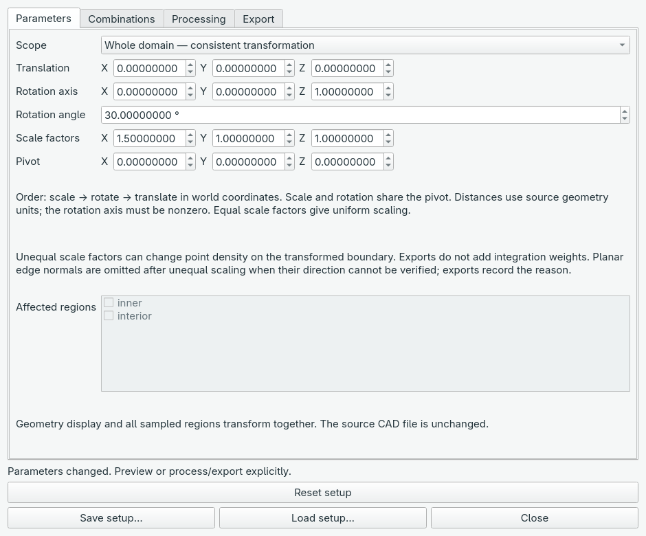

The order is scale, rotate, then translate. Scale and rotation share the pivot.
Whole-domain mode transforms the geometry display and all sampled clouds together.
Selected-region mode moves only checked clouds, with unverified domain consistency.
Distances retain the CAD source units; no unit conversion is inferred.

#### 2. Preview and restore

Open **Processing** and click **Preview configuration**. The annulus display and
samples become a rotated ellipse. Editing fields alone does not update the view;
click Preview again when you want to inspect new values. You can move the dialog
aside to see the viewport.

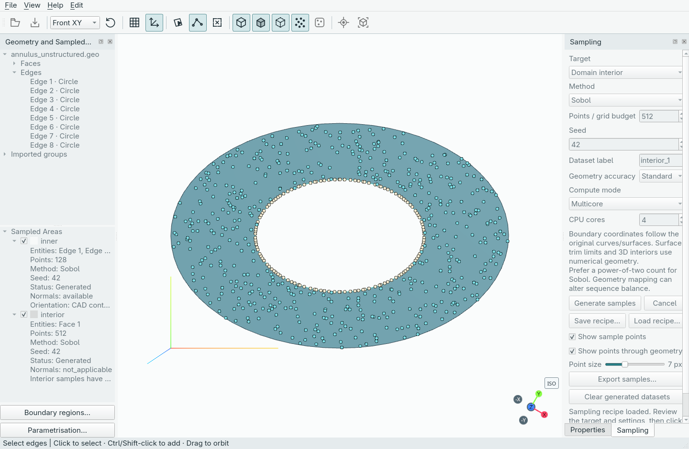

Click **Restore original view** to remove the preview while keeping your values.
Closing the workspace also clears the preview. **Reset setup** resets both the
values and display to the original configuration. Transforms use the original
samples every time; they do not regenerate CAD or resample the domain.

For a single output, use **Export → Process configuration and export…** and
choose NetCDF or NPZ. The saved file contains transformed points and provenance;
the original samples remain in the project.

#### 3. Make several configurations

Open **Combinations**, check **Use a parameter design**, and use **Add parameter**
for each named value. For the six-row example pictured here, choose
**Cartesian product** and enter:

| Name | Target | Mode | Explicit values |
| --- | --- | --- | --- |
| angle | Rotation angle | Values | `0, 30, 60` |
| shift | Translation X | Values | `0, 1` |

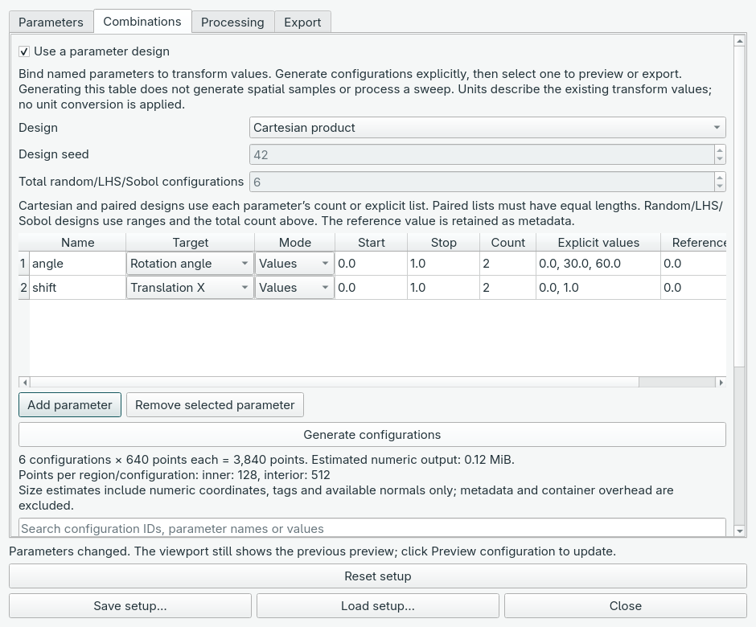

The summary shows **6 configurations × 640 points each = 3,840 points** for this
example. The original clouds contain 128 boundary points and 512 interior points;
those counts remain independent in every configuration. The disabled total-random
count does not control Cartesian products; each parameter's list does.

Click **Generate configurations**, then scroll down to the table. Select a row
and click **Preview selected configuration** to inspect it. Selection alone does
not change the viewport. **Export selected configuration…** exports just that row.

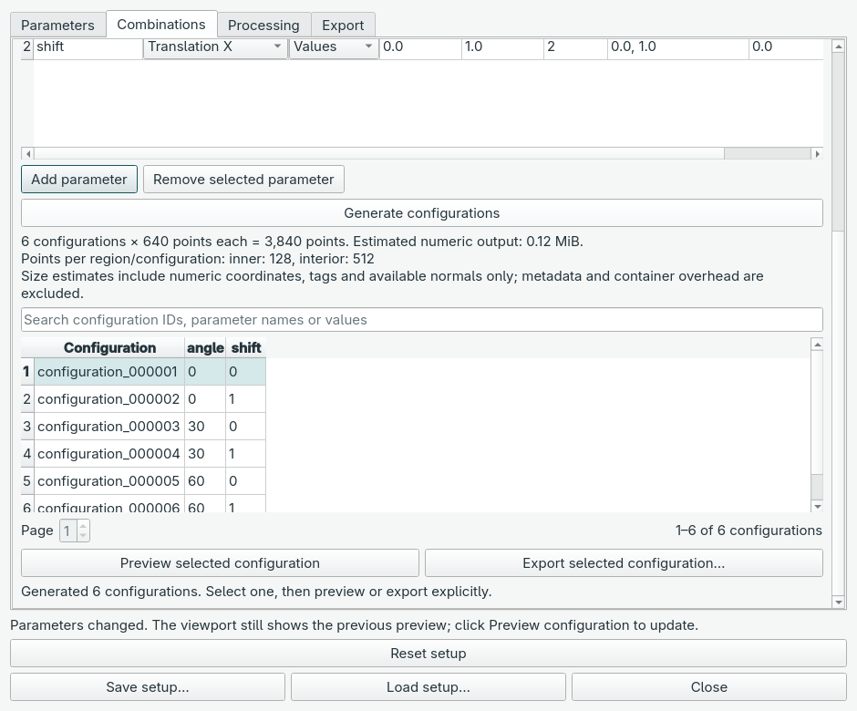

Search by configuration ID, parameter name or value to find rows. Searching only
filters the table; it does not reduce a full sweep export. If you edit a transform
or design definition, generate the configurations again before using them.

#### 4. Keep only the configurations you want

In **Combinations**, click **Add constraint**. For the six-candidate example
above, enter rule name `limit_angle`, left parameter `angle`, comparison `<=`,
right kind **Constant**, and right value **30**. Click **Generate configurations**
again. Four candidates are accepted and the two 60-degree candidates are rejected.
The parameter lists and all candidate values stay unchanged.

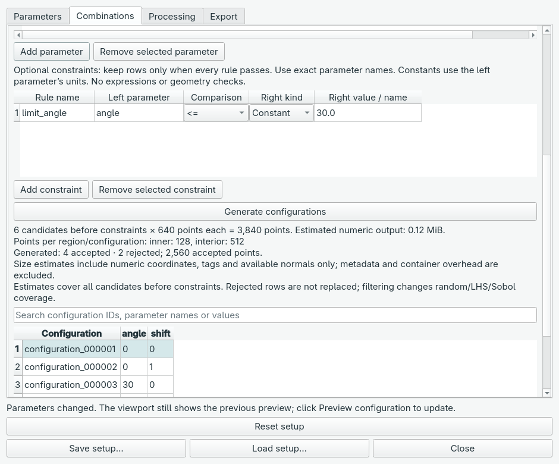

Use **Parameter** as the right kind to compare two named parameters, for example
`shift_x <= shift_y`; enter the exact name in the final column. Both must use the
same units. Constants use the left parameter's units. Renaming a parameter requires
updating rules that refer to its old name. Rules are combined with AND: every rule
must pass. They do not check whether CAD or a physical model is valid.

Click **Rejected configurations…** to see which candidates were excluded and why.
You can search IDs, named values and reasons. The surviving configurations retain
their original IDs, so gaps in the accepted table are expected.

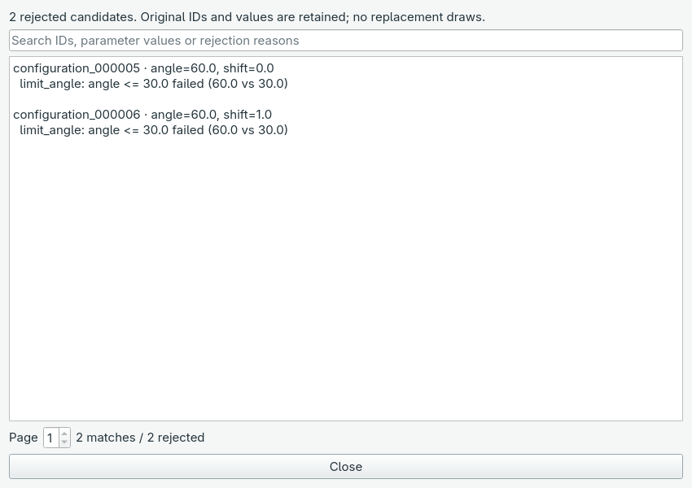

The summary before generation estimates all candidates, before filtering. The
status after generation reports actual accepted/rejected counts. If every candidate
is rejected, review the rules before processing. Random/LHS/Sobol filtering does
not draw replacements and can change coverage; the result may no longer be
balanced. Equality is exact; use appropriate inequalities for floating values.


#### 5. Export the whole design

Open **Processing**. Choose **Output format** and the **On error** policy, then
click **Export generated design…** and choose a new output-folder name.
This processes every accepted generated configuration in the design. Rejected
candidates are recorded in the report but do not create output files.

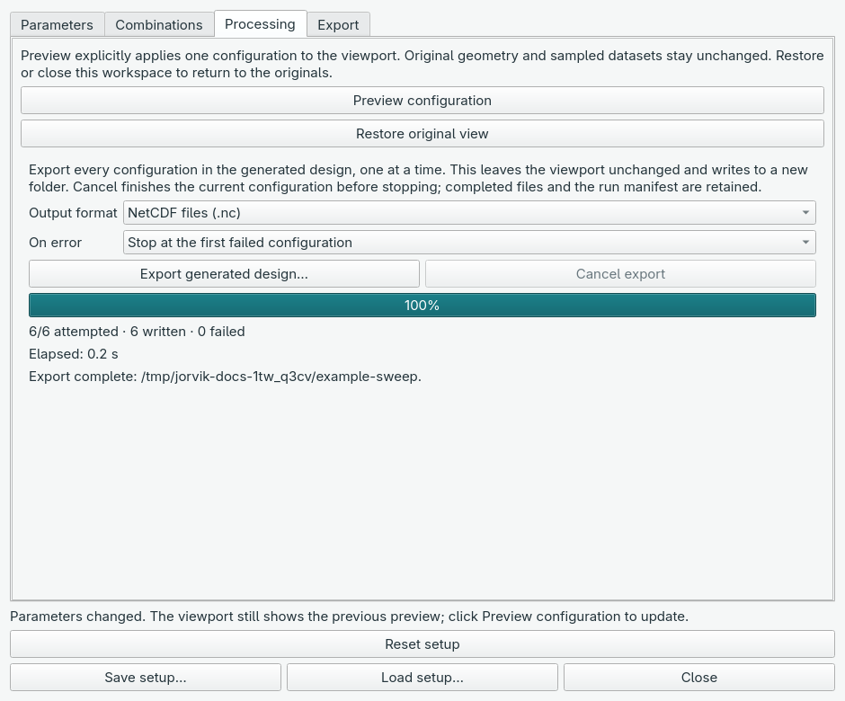

Progress reports attempted, written and failed configurations, plus elapsed time.
**Cancel export** finishes the current file and stops before the next. Completed
files remain available. With no constraints, a successful six-row run shows **6/6 attempted · 6 written ·
0 failed**, as above. The angle constraint example exports only four accepted rows. Partial and failed runs retain their status and error records;
use **Resume/retry saved sweep…** to continue a compatible run into a new folder.

Save the project to retain your transform and design definitions. Reopening the
project restores the definitions; click **Generate configurations** again to
rebuild the table. For Python consumers, the separate code recipes explain how
to verify exported files and read one configuration at a time.


#### 6. Inspect and verify exported results

Choose **File → Inspect exported sweep…** and select the output folder. You can
inspect a sweep without opening its source project or loading geometry first.
The window shows run status, complete/failed/pending counts, dataset point counts
and a searchable configuration table. Pages contain at most 200 rows.

Click **Verify completed files** to check the successful files. Verification runs
in the background and checks the file contents, shapes, source/setup/parameter
provenance, and any recorded SHA-256 checksums. Searching filters the table, not
the files checked. A **Verified** row means its checks passed; a file error is
shown in that row and in the status message. Verification stops at the first bad
file, leaving later rows **Not checked**.

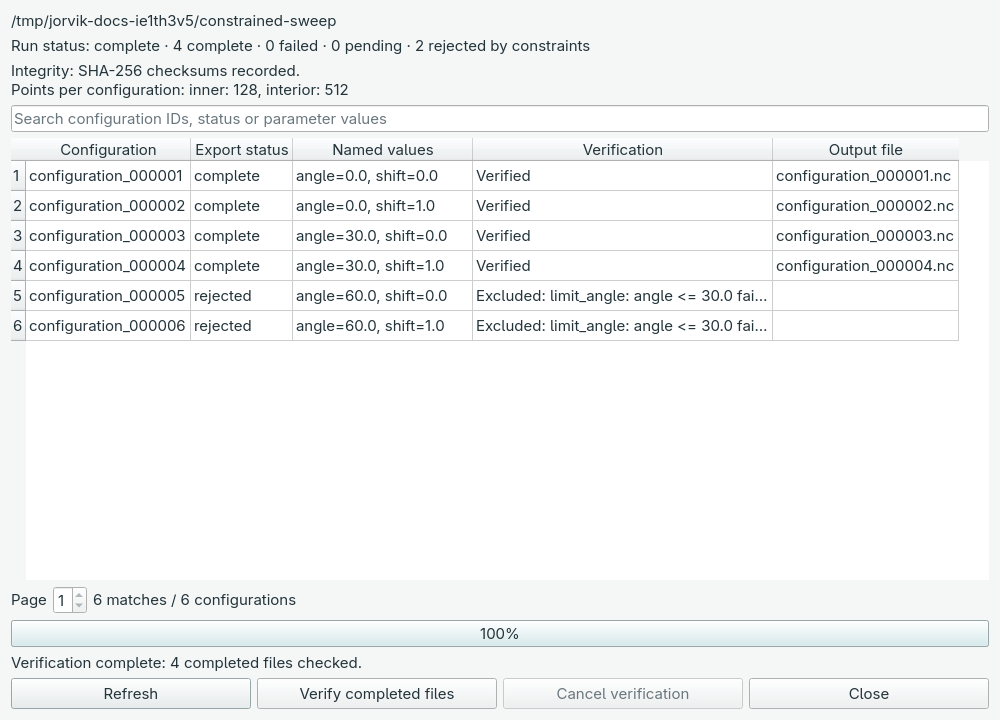

The inspector also displays cancelled, failed and interrupted runs; successful
rows can be verified while failed and pending rows remain clearly marked.
**Cancel verification** stops the read-only check without changing any files.
**Refresh** reads the folder again and clears previous verification results.
Keep the folder unchanged while inspecting it; the display is a snapshot, not a
live monitor. Closing the inspector cancels active inspection safely.

Older sweeps without checksums remain inspectable, with a visible **Legacy run**
message. Their verification checks structure and provenance only. New sweeps also
check recorded hashes. Neither kind of verification certifies geometry accuracy
or validates physics, and the inspector does not modify the current workspace.


#### 7. Resume or retry a saved sweep

Keep the original sampled datasets and transform/design definition, then click
**Generate configurations** again if you reopened the project. In **Processing**,
click **Resume/retry saved sweep…**, select the earlier output folder and choose
a **new** output-folder name outside the earlier run. The earlier run stays intact.

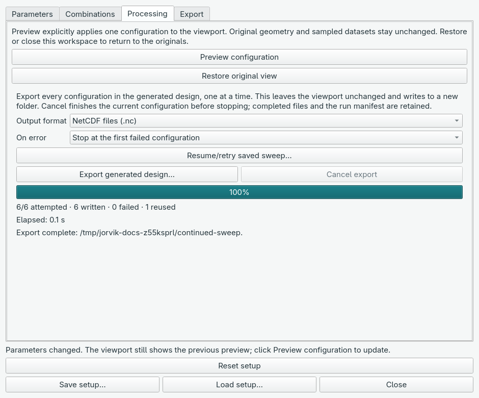

Jorvik checks that original coordinates, tags, normals and dataset metadata match
the saved input fingerprint. It also compares the base setup and ordered scalar
plan, and verifies every completed file's checksum and contents before creating
the new folder. **Reused** counts successful files copied into the new run;
failed and pending configurations are generated using their original IDs. The
original NetCDF/NPZ format is retained, and the selected **On error** policy
applies to this attempt. The inspector shows the source run and reuse count.

A changed sample, recipe, label, colour, transform or design is rejected. Use the
saved project containing the original data; regenerating samples may produce
different inputs. Older sweeps without an input fingerprint/checksums cannot be
continued safely: start a fresh export instead. A corrupt completed file also
stops preflight with an error; the source is never repaired or overwritten.

**Cancel export** works while verifying or processing. Cancelling verification
leaves no new output folder. After processing starts, the current atomic copy or
export finishes, then the run stops and retains its partial records. You can
continue that new run later into another new folder. Keep the source folder
unchanged throughout continuation; this does not coordinate with other writers.


## Installing and launching Jorvik

Jorvik is a desktop GUI. This development preview is currently installed from a
source checkout with Python 3.12 or newer and uv. Run this once to install its
locked dependencies, then launch the app:

```sh
uv sync --locked
uv run jorvik
```

After the window opens, use **File → Open Geometry…** or **Open project…**.
Normal sampling, region editing, transforms, saving and exporting happen in the
GUI. You do not need to run a command for each operation. There is no standalone
installer documented for this preview yet. If Jorvik is already installed in an
existing environment, launch its installed `jorvik` application.

For rendering compatibility from a checkout, launch with
`uv run jorvik --software-rendering`. **Help → Graphics information** displays
the renderer details in the app. Host-environment installation and launching a
project from another application are covered in the separate code recipes.


## Development preview and release checks

This remains **0.1.0.dev0**, a development preview. The current release slice
supports import/selection, user-defined boundary regions, labelled sampling,
applicable outward normals, NetCDF/NPZ exports, project persistence and explicit
transform previews. Region labels carry metadata; physics and solvers remain
outside the application.

On 16 October 2026 the built wheel was installed into a separate environment
using the locked dependencies and validated on macOS arm64 (27.0.1), Python
3.12.13. The installation check imported from that environment's `site-packages`,
verified packaged offline assets/licences, rendered samples in the real WebGL
viewport, and checked CAD topology, boundary/interior sampling, normals,
NetCDF/NPZ round trips and project restoration. The command-line entry point
reported `Jorvik 0.1.0.dev0`. This does not establish Windows/Linux support.

To repeat installation validation from a checkout on macOS/Linux:

```sh
uv build
uv export --locked --no-dev --no-emit-project --no-hashes --output-file /tmp/jorvik-requirements.txt
uv venv /tmp/jorvik-release-check
uv pip install --python /tmp/jorvik-release-check/bin/python -r /tmp/jorvik-requirements.txt dist/jorvik-0.1.0.dev0-py3-none-any.whl
/tmp/jorvik-release-check/bin/python -I scripts/validate_installation.py --installed --render
/tmp/jorvik-release-check/bin/jorvik --version
```

`--render` needs a desktop session; omit it for geometry/export checks alone.
The validator uses temporary files and isolated Qt settings. It does not change
an existing user's project or settings. Use a fresh environment directory for
each installation check. The historical macOS check above used Gmsh 4.15.2,
NumPy 2.5.3, SciPy 1.18.1, xarray 2026.9.0 and PySide6 6.11.2.

On 29 October 2026, Linux/Wayland compatibility was checked with Python 3.14.8
and PySide6 6.12.0. All 53 Jorvik tests passed in a separate compatibility
environment. The built wheel was then installed into an existing application's
Python 3.14 environment with its existing packages constrained; NumPy 2.5.2,
PySide6 6.12.0 and the CUDA-enabled Torch installation remained unchanged.
All 53 tests also passed using the package installed in the shared environment.
The installed-package validator passed with Gmsh 4.15.2, SciPy 1.18.1 and
xarray 2026.9.0, including the offline viewport, sampling, normals, NetCDF/NPZ
round trips and project restoration. Fourteen focused host-application tests
also passed, including CUDA numerical checks, dataset import, sampling controls
and model-file lifecycle. The standalone Python 3.12.15 environment passed the
same geometry/export/rendering validator with PySide6 6.12.0. These are local
installation checks; Windows and broader distribution coverage remain pending.

Jorvik still requires Python 3.12 or newer. Its standalone `.python-version`
remains 3.12; this does not require another application's environment to use
3.12. Install Jorvik with the receiving environment's interpreter. From a source
checkout, build the wheel, then target that existing environment explicitly:

```sh
uv build
uv pip install --python /path/to/host/.venv/bin/python dist/jorvik-0.1.0.dev0-py3-none-any.whl
uv pip check --python /path/to/host/.venv/bin/python
```

Jorvik pins PySide6 6.12.0 to share Qt with the receiving application. Include
Jorvik in that application's dependency declarations if its environment manager
should retain/reinstall it during future synchronisation. A wheel installation
is a snapshot; rebuild and reinstall it after making Jorvik changes.

Run the attributed annulus example from a checkout:

```sh
uv run python examples/sample_annulus.py --output-dir /tmp/jorvik-annulus --count 128
```

It creates independent `inner`, `outer` and `interior` arrays in `annulus.nc` and
`annulus.npz`, with outward boundary co-normals and immutable region provenance.
It reloads both exports, checks matching arrays, and prints the resulting shapes.
The Python example shows how to obtain separate training coordinates and normal
arrays for downstream scientific ML. Its face/edge identifiers are specific to
the included CFDBench annulus; do not reuse them blindly with other CAD.

Before a general release, finish broader CAD trim/containment validation,
small-feature and normal-orientation checks, real exporter compatibility,
large-project memory reductions/viewport measurements and cross-platform
installation checks. Unknown units and assembly metadata remain
explicit limitations. Affine rotation/scaling and sequential parameter sweeps are
implemented in the current development preview; CAD regeneration and licensed
translators remain later roadmap work.

## Practical recipes

These are optional **Python and command examples** for developers and downstream
data consumers. For normal use, follow the screenshot-based GUI walkthroughs.

These recipes cover installation, project hand-off, sampling, exports, transforms,
parameter designs and training reads. Python snippets from **Create an empty
project** onward form one worked example: run them in order in a Python session
started from the repository root with `uv run python`. They write to
`recipe-output/`; use a fresh folder when repeating project creation or sweep
export. Geometry entity IDs below belong only to the included annulus fixture.

#### Install and launch

From a checkout, install the locked environment and open geometry:

```sh
uv sync --locked
uv run jorvik examples/geometries/cfdbench/annulus_unstructured.geo
# Open an editable project instead:
uv run jorvik path/to/model.jorvik
# Use the compatibility renderer when needed:
uv run jorvik --software-rendering path/to/model.jorvik
```

The `path/to/model.jorvik` commands assume that document already exists. Jorvik
reports a missing or invalid file; launching does not create it. Legacy `.gsproj`
documents remain readable. Project files preserve editable work; `.nc` and `.npz`
files contain exported data.

To install a GitHub revision into another application's **existing** environment,
replace `/path/to/host` and `COMMIT_SHA` with its actual location and a pushed commit:

```sh
uv pip install --python /path/to/host/.venv/bin/python "jorvik @ git+https://github.com/praksharma/Jorvik.git@COMMIT_SHA"
uv pip check --python /path/to/host/.venv/bin/python
/path/to/host/.venv/bin/jorvik --version
```

Only pushed commits are available through GitHub. For unpushed local work, use
`uv pip install --python /path/to/host/.venv/bin/python -e .` from this checkout.
The host must meet Jorvik's Python/dependency requirements, including its PySide6
pin. Declare the dependency in the host's own project configuration to retain it
across environment synchronisation. These commands target that environment;
they do not require changing Jorvik's standalone Python version.

#### Create an empty project

This API does not import Qt or start the GUI:

```python
from pathlib import Path
from jorvik.project import create_empty_project, load_project

out = Path("recipe-output")
out.mkdir(exist_ok=True)
project = create_empty_project(out / "model.jorvik")
manifest, geometry_or_none = load_project(project)
assert geometry_or_none is None
print(project)  # recipe-output/model.jorvik
```

An existing destination raises `FileExistsError`. Use `overwrite=True` only for
intentional replacement. To edit the document, launch `jorvik
recipe-output/model.jorvik`, choose **Open geometry**, then **Save project**.
The imported geometry is saved back into that same project file.

An external application's launch code can be as small as this (run separately,
in the environment where Jorvik is installed):

```sh
/path/to/host/.venv/bin/jorvik /absolute/path/to/model.jorvik
```

For a Python host, use `subprocess.Popen([str(jorvik_executable), str(project)])`
with the installed executable's absolute path. Pass arguments as a list so paths
with spaces stay intact. There is no dependency on the calling application and
no live synchronisation between applications.

`create_empty_project(path, *, overwrite=False)` returns a `pathlib.Path` and
accepts `.jorvik` (preferred) or legacy `.gsproj` and requires an existing parent
directory. It atomically creates a complete archive, raising `FileExistsError` if the destination already
exists. Pass `overwrite=True` only when replacement is intended. Empty documents
use project schema **3**, with `geometry: null`, no datasets, no source and empty
state; they cannot contain geometry references or embedded source data. Their
loader returns `(manifest, None)`. Populated projects keep schema **2**, and
existing schema **1/2** projects retain their normal validation. Empty workspace
view preferences are supplied by the application's settings rather than stored
in the document.

#### Generate labelled samples without the GUI

Create a boundary region on the annulus's four inner arcs, then sample that region
and the interior with different counts. The seed controls spatial sampling.

```python
from jorvik.geometry import load_geometry
from jorvik.regions import put_region, region_snapshot
from jorvik.sampling import sample_geometry
from jorvik.export import export_samples

geometry = load_geometry("examples/geometries/cfdbench/annulus_unstructured.geo")
regions = put_region([], geometry, "inner", [[1, tag] for tag in range(1, 5)], "#ffc857")
inner = regions[0]
batches = []
for label, count, region in [("inner", 32, inner), ("interior", 64, None)]:
    request = {key: geometry[key] for key in ("source", "source_hash", "document")}
    request.update(
        label=label, count=count, target="region" if region else "interior",
        entities=region["entities"] if region else [], method="sobol", seed=42,
        resolution=32, compute_mode="reproducible", cpu_threads=1,
    )
    if region:
        request["boundary_region"] = region_snapshot(regions, geometry, region["id"])
    batches.append(sample_geometry(request))

export_samples(batches, out / "samples.nc")
export_samples(batches, out / "samples.npz")
print([(batch["label"], batch["count"]) for batch in batches])
# [('inner', 32), ('interior', 64)]
```

Coordinates remain in unspecified source geometry units. Region labels are
arbitrary metadata, with no assigned boundary-condition values. For a complete
standalone script including round-trip checks, run
`uv run python examples/sample_annulus.py --output-dir annulus-output --count 128`.

#### Load every label, including spaces and Unicode

Read the label map rather than guessing internal variable names. Copy arrays
inside the context manager so they remain independent after the file closes.

```python
import json
import xarray as xr
import numpy as np

with xr.open_dataset(out / "samples.nc", engine="scipy") as dataset:
    records = json.loads(dataset.attrs["metadata_json"])["datasets"]
    nc_points = {record["label"]: dataset[record["array"]].values.copy()
                 for record in records}
    nc_tags = {record["label"]: dataset[record["entity_tags"]].values.copy()
               for record in records}
    nc_normals = {record["label"]: dataset[record["normals"]].values.copy()
                  for record in records if "normals" in record}

with np.load(out / "samples.npz", allow_pickle=False) as archive:
    records = json.loads(archive["_gs_metadata"].item())["datasets"]
    npz_points = {record["label"]: archive[record["array"]].copy()
                  for record in records}

for label in nc_points:
    np.testing.assert_array_equal(nc_points[label], npz_points[label])
print({label: points.shape for label, points in nc_points.items()})
# {'inner': (32, 3), 'interior': (64, 3)}
```

Normals are optional: test for their presence in the label map. The annulus inner
boundary has planar co-normals; its interior has no outward normal. Metadata
records unavailable-normal reasons for other geometry. Independent point counts
stay independent; do not concatenate boundary and interior arrays merely to make
one rectangular dataset.

#### Save and rebind a sampling recipe in Python

This continues with the last sampling `request`, loaded `geometry` and saved
`regions` from the earlier annulus example. Include the importer provenance when
preparing a recipe; it is available on the loaded geometry.

```python
from jorvik.sampling_recipe import create_recipe, save_recipe, load_recipe, bind_recipe

recipe_request = dict(request, source_format=geometry["source_format"],
                      import_options=geometry["import_options"])
recipe = create_recipe(recipe_request)
save_recipe(recipe, out / "interior.sampling.json")
restored_request = bind_recipe(load_recipe(out / "interior.sampling.json"), geometry, regions)
assert restored_request["target"] == "interior"
assert restored_request["count"] == 64
# sample_geometry(restored_request) explicitly generates a fresh dataset.
```

These APIs are Qt-independent. Recipe schema **1** uses
`kind="jorvik_sampling_recipe"`, `geometry` identity/import metadata and `sampling`
settings. `create_recipe` extracts settings from a generation request; it does not
save a generated batch's point arrays. `save_recipe` validates first and writes
atomically, preserving an existing file if writing fails. `load_recipe` validates
JSON without executing CAD; `bind_recipe` validates loaded entity/region/group
references and returns a fresh generation request for the current document.
The API supports accuracy 16/32/64 and uint32 seeds; the GUI applies its narrower
workspace limits. Use the Sampling pane's Load recipe action for these JSON files,
not Open project or Load transform setup.

#### Save a transform and export one configuration

The setup binds to the actual geometry hash, applies scale → rotation → translation
about a shared pivot, and preserves the original samples. Here a whole-domain
configuration rotates 30 degrees about Z, then translates one source unit in X.

```python
from jorvik.parametrisation import save_setup, load_setup, export_configuration

base = {
    "schema_version": 2, "scope": "domain", "regions": [],
    "source_hash": geometry["source_hash"],
    "translation": [1.0, 0.0, 0.0],
    "rotation_axis": [0.0, 0.0, 1.0], "rotation_angle": 30.0,
    "angle_units": "degrees", "scale": [1.0, 1.0, 1.0],
    "pivot": [0.0, 0.0, 0.0],
    "order": ["scale", "rotate", "translate"], "frame": "world",
}
save_setup(base, out / "transform.json")
restored = load_setup(out / "transform.json")
export_configuration(batches, restored, out / "one-configuration.nc")
```

For selected clouds only, set `scope` to `"regions"` and `regions` to their exact
dataset labels, for example `["inner"]`. CAD remains fixed in that preview;
boundary/interior consistency is unverified. Scaling must be positive. New planar samples retain the frames needed to preserve
co-normals under non-uniform scaling; older samples without frames omit those
arrays until regenerated. Transforms do not resample the geometry or provide
integration weights.

For example, stretch the annulus into an ellipse and retain its outward boundary
co-normals. This continues with the `batches` and `base` defined above:

```python
from jorvik.parametrisation import transform_batches

stretched_setup = dict(base, scale=[2.0, 3.0, 1.0])
stretched_inner = transform_batches(batches, stretched_setup)[0]
assert stretched_inner["normal_status"] == "available"
assert "normal_planes" in stretched_inner
np.testing.assert_allclose(np.linalg.norm(stretched_inner["normals"], axis=1), 1.0)
export_configuration(batches, stretched_setup, out / "stretched.nc")
```

Each sampled edge's unit plane normal is recorded in `normal_planes`; it specifies
a direction, not a plane origin or CAD regeneration parameter.

#### Generate a parameter design

This Cartesian design assigns three rotation angles and two X translations,
producing six scalar configurations. Named values assign transform components
absolutely: `shift=0` replaces the base translation of 1; it does not add to it.

```python
from jorvik.parameter_design import design_summary, generate_configurations

design = {
    "schema_version": 1, "method": "cartesian", "seed": 42, "count": 6,
    "parameters": [
        {"name": "angle", "target": "rotation_angle", "mode": "values",
         "values": [0.0, 30.0, 60.0], "reference": 0.0, "unit": "degrees"},
        {"name": "shift", "target": "translation_x", "mode": "values",
         "values": [0.0, 1.0], "reference": 0.0, "unit": "source"},
    ],
}
base["design"] = design
summary = design_summary(design, batches)
configurations = generate_configurations(base, design)
print(summary["count"], summary["total_points"])  # 6 576
print(configurations[0]["id"], configurations[0]["parameters"])
# configuration_000001 {'angle': 0.0, 'shift': 0.0}
export_configuration(batches, configurations[0]["setup"], out / "selected.npz")
```

For Cartesian/paired designs, each parameter's list length or range `count`
determines the configuration count. The top-level `count` controls stochastic
methods. The reference value is descriptive metadata. Generating configurations
allocates scalar plans, not six copies of the point clouds.

For a seeded Sobol design instead, use ranges and a power-of-two total count:

```python
sobol_design = {
    "schema_version": 1, "method": "sobol", "seed": 42, "count": 8,
    "parameters": [
        {"name": "angle", "target": "rotation_angle", "mode": "range",
         "start": 0.0, "stop": 60.0, "reference": 0.0, "unit": "degrees"},
    ],
}
sobol_base = {key: value for key, value in base.items() if key != "design"}
sobol_base["design"] = sobol_design
sobol_configurations = generate_configurations(sobol_base, sobol_design)
assert len(sobol_configurations) == 8
```

Use `"random"` or `"lhs"` in place of `"sobol"` for the other seeded range
methods. Use `"paired"` with equal-length value lists to pair entries by position
instead of taking their Cartesian product. Design seeds are separate from spatial
sampling seeds. Plans are limited to 10,000 configurations.

#### Export a sweep and verify training arrays

Continue with the six-row Cartesian `base` and `configurations` above. The output
directory must not already exist. NetCDF is the default; set `file_format="npz"`
for NumPy shards.

```python
from jorvik.sweep_export import export_sweep
from jorvik.sweep_results import inspect_sweep, iter_sweep_datasets, training_arrays

run = out / "sweep"
result = export_sweep(batches, base, configurations, run, file_format="nc")
assert result["status"] == "complete"
assert len(inspect_sweep(run, require_integrity=True)["completed"]) == 6

for configuration in iter_sweep_datasets(run, require_integrity=True):
    columns = ["x", "y", "z", *configuration["parameters"]]
    inputs = training_arrays(configuration)
    assert columns == ["x", "y", "z", "angle", "shift"]
    assert inputs["inner"].shape == (32, 5)
    assert inputs["interior"].shape == (64, 5)
    # Feed each label's array to downstream code here.
    # Normals/tags remain in configuration['datasets'].
```

Each shard is checked against its SHA-256 hash before loading. Only one
configuration's arrays need to stay in memory; converting the iterator to a list
retains all of them. `require_integrity=True` rejects legacy runs without hashes.
Checksums detect accidental changes, not replacement of files and hashes together.

For an intentionally partial run, opt in explicitly. To request cancellation in
a non-GUI caller, pass a callable such as `cancelled=stop_event.is_set` to
`export_sweep`; the current file finishes before stopping. `fail_fast=False`
attempts later configurations after a failure. Completed files remain readable
with `iter_sweep_datasets(run, allow_partial=True, require_integrity=True)`;
failed and pending entries are not yielded. Use `resume_sweep` explicitly to continue a compatible run into a new folder.

From a checkout, inspect status or verify all completed files:

```sh
uv run python tools/inspect_sweep.py recipe-output/sweep
uv run python tools/inspect_sweep.py recipe-output/sweep --verify --require-integrity
# Explicitly allow successful outputs from a partial run:
uv run python tools/inspect_sweep.py recipe-output/sweep --allow-partial --verify
```

#### Continue a compatible sweep in Python

Using the original `batches`, `base` and `configurations` from the examples above:

```python
from jorvik.sweep_export import resume_sweep

continued = resume_sweep(batches, base, configurations, run, out / "continued-sweep")
assert continued["status"] == "complete"
assert continued["reused_count"] == 6  # This example's source run already completed.
```

For a partial source run, completed files are copied after validation and the
remaining configurations are regenerated. The destination must be new and
outside the source. No hard links or in-place modifications are used. The manifest
records `resumed_from`, `reused_count`, and a versioned `input_fingerprint`; reused
journal entries include `reused: true`. An input fingerprint covers ordered
original numeric buffers and their metadata, using SHA-256 and canonical numeric
storage. The fingerprint is separate from the plan/shard checksums.

Pass `cancelled`/`progress` callbacks and `fail_fast` as for `export_sweep`.
Preflight progress uses `stage="verifying"`, `verified_count` and
`verification_total`. Cancellation in preflight raises `InterruptedError` without
creating output; cancellation after destination creation returns a cancelled run
manifest. Existing readers remain compatible with older sweeps, but continuation
requires a fingerprint created by a version that supports this feature.

#### Apply literal constraints in Python

This uses the Cartesian `base` and `design` from the preceding examples:

```python
from copy import deepcopy
from jorvik.parameter_design import generate_design

constrained_design = deepcopy(design)
constrained_design["constraints"] = [
    {"name": "limit_angle", "left": "angle", "operator": "<=", "right": {"value": 30.0}}
]
constrained_base = dict(base, design=constrained_design)
report = generate_design(constrained_base, constrained_design)
assert len(report["accepted"]) == 4
assert len(report["rejected"]) == 2
assert report["rejected"][0]["id"] == "configuration_000005"
export_sweep(batches, constrained_base, report["accepted"], out / "constrained-sweep")
```

`generate_design` returns `accepted`, `rejected` and `candidate_count`.
`generate_configurations` remains available and returns only accepted records.
For parameter comparisons, use `"right": {"parameter": "other_name"}` instead of
a constant. Read rejected IDs/values/reasons with `inspect_sweep(path)["rejected"]`;
`iter_sweep_datasets` yields successful accepted outputs only. The full sweep
example exports all four accepted rows, independently of table search/selection.

#### Desktop shortcuts and common tasks

| Task | Steps | Result |
| --- | --- | --- |
| Create a boundary region | Select edges/faces → **Boundary regions…** → name → **Save region** | Labels existing CAD entities; no geometry partitioning |
| Compare sampling methods | Generate a dataset, change method/seed, generate another | Separate labelled datasets you can show/hide |
| Undo or redo an edit | `Ctrl+Z`; `Ctrl+Shift+Z` or `Ctrl+Y` | Restores supported edits within the current document's 30-entry history |
| Duplicate or delete data | Right-click a sampled dataset → **Duplicate dataset** / **Delete dataset** | Undoable dataset edits; duplication does not resample |
| Preview a transform | **Parametrisation…** → edit **Parameters** → **Preview configuration** | Explicit preview from original points |
| Restore original display | **Restore original view** | Clears the preview while retaining setup values |
| Make a design | **Combinations** → enable design → add parameters → **Generate configurations** | Scalar rows; selecting one alone does not preview it |
| Find a configuration | Type an ID, parameter name or value into the search box | Filters the table; does not reduce a full sweep export |
| Process all configurations | **Processing** → **Export generated design…** → new folder | Background export, progress and cancellation |
| Recover interrupted work | Use the recovery workflow on the **Projects and recovery** page | Review recovery copies before replacing saved work |

Saving a project retains transform/design definitions, but not the generated
configuration table or session undo history. Reopen it, then explicitly generate
configurations again. See the topic pages for selection, normals, recovery and
accuracy limitations in more detail.
