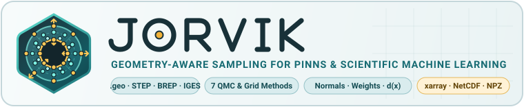
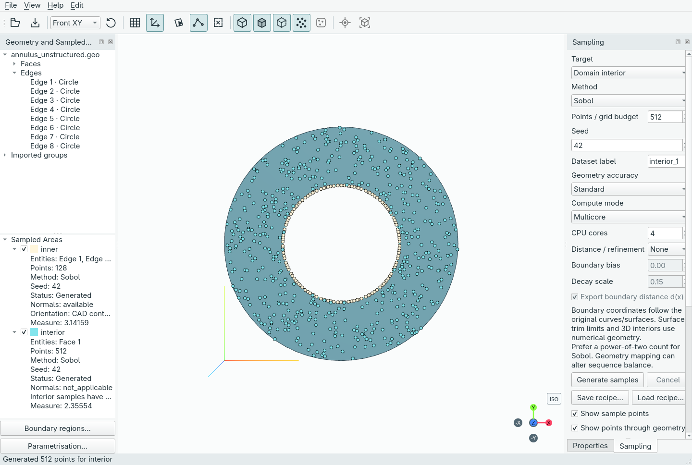

<p align="center">
  <picture>
    <source media="(prefers-color-scheme: dark)" srcset="docs/assets/branding/jorvik-logo-dark.svg">
    <source media="(prefers-color-scheme: light)" srcset="docs/assets/branding/jorvik-logo.svg">
    
  </picture>
</p>

<p align="center">
  <a href="https://praksharma.github.io/Jorvik/"></a>
  <a href="LICENSE"></a>
  
  
  
</p>

**Jorvik** is an offline desktop application and Qt-independent Python library for **geometry-aware collocation and boundary sampling** in Physics-Informed Neural Networks (PINNs), neural operators, and scientific machine learning.



## Highlights

- **Topology-Preserving CAD Import**: Open Gmsh `.geo` (built-in and Open CASCADE kernels), STEP (`.step`, `.stp`), Open CASCADE BREP (`.brep`), and IGES (`.iges`, `.igs`) with automatic STEP/IGES header unit detection (`mm`, `m`, `in`, etc.), synchronized 3D viewport/tree picking, and multi-volume 3D subdomain targets.
- **Seven Spatial Sampling Methods**: Uniform random, regular parameter/bounding-box grid, Latin hypercube (LHS), Sobol, Halton, Hammersley, and recursive stratified sampling across 1D curves, 2D trimmed surfaces, 2D planar sheets, and 3D solid volumes (with Multicore HXT or serial Reproducible meshing).
- **Verified Normals, Quadrature Weights & Boundary Distance $d(\mathbf{x})$**: Orientation-verified outward surface normals and planar co-normals, per-point measure/quadrature weights (`weights`, `domain_measure`) with exact affine Jacobian transport, unsigned boundary distances (`boundary_distances`), and importance-weighted boundary-layer spatial refinement.
- **Parametric Transforms, CAD Regeneration & Sweeps**: Reversible viewport previews of `scale → rotate → translate` transformations, automatic `.geo` script parameter discovery (`Geo: <name>`) for topological dimensional CAD regeneration sweeps, Cartesian/Paired/Random/LHS/Sobol parameter designs with literal constraints, and checksum-verified background sweep export.
- **Scientific ML Exports**: Primary `xarray.Dataset` / `xarray.DataTree` interface persisted as NetCDF (`.nc`) or pickle-free NumPy archives (`.npz`), plus single-file consolidated sweep bundles (`sweep_bundle.nc` / `.npz`) and portable `.jorvik` project archives.

## Quick start

Launch from a checkout with Python 3.12+ and [uv](https://docs.astral.sh/uv/):

```sh
uv sync --locked
uv run jorvik
```

Choose **File → Open Geometry…**, select original faces or edges, group them under **Boundary regions…**, and click **Generate samples** in the Sampling pane. Save editable workspaces with **File → Save project** (`.jorvik`) or export training arrays with **File → Export samples…** (`.nc` / `.npz`).

## Illustrated tutorials & documentation

Read the [documentation site](https://praksharma.github.io/Jorvik/) or the canonical [GUIDE.md](GUIDE.md):

| Tutorial / Reference | Topics Covered |
| --- | --- |
| [**1. Your first dataset in the GUI**](https://praksharma.github.io/Jorvik/guide/getting-started/) | 2D annulus import, edge selection, boundary regions, Sobol sampling, recipes, and lightweight project copies |
| [**2. 3D sphere cutaway & volume sampling**](https://praksharma.github.io/Jorvik/guide/tutorial-3d-sphere/) | 3D face picking, hiding front patches for cutaway views, 3D tetrahedral volume sampling, region isolation, and dark theme |
| [**3. STEP & BREP neutral CAD workflows**](https://praksharma.github.io/Jorvik/guide/tutorial-cad-workflows/) | Open CASCADE `.brep` and `.step` solids, verified outward surface normals, open shells, and degenerate edge protection |
| [**4. Comparing methods & editing areas**](https://praksharma.github.io/Jorvik/guide/tutorial-editing-and-comparison/) | Side-by-side comparison of all 7 sampling methods, atomic in-place **Edit…** regeneration, duplication, and 30-step Undo/Redo |
| [**5. Transforms & Cartesian sweeps**](https://praksharma.github.io/Jorvik/guide/transforms-and-sweeps/) | Reversible affine previews, Cartesian parameter designs, constraints, background sweep export, resume/retry, and Sweep Inspector |
| [**6. LHS sweeps, augmentation & PINNs**](https://praksharma.github.io/Jorvik/guide/tutorial-parametric-lhs-and-augmentation/) | Multi-parameter LHS designs, parameter-to-parameter ordering constraints, region augmentation, and streaming PINN training loops |
| [**7. Quadrature weights, $d(\mathbf{x})$ refinement & CAD sweeps**](https://praksharma.github.io/Jorvik/guide/tutorial-advanced-pinn-workflows/) | Per-point integration weights, boundary-distance refinement, `.geo` dimensional CAD regeneration sweeps, and `xarray.DataTree` bundles |
| [**Python & CLI recipes**](GUIDE.md#practical-recipes) · [**Exports schema**](https://praksharma.github.io/Jorvik/reference/exports/) | Headless Python sampling, NetCDF/NPZ/DataTree loading, runnable [annulus example](examples/sample_annulus.py), and [roadmap](TODO.md) |

## Scope & attribution

CAD models already contain the boundary partitions needed for region assignment; Jorvik labels and samples them while keeping PDE solvers and prescribed physical boundary values in downstream training code. Application shell adapted from PyniteGUI ([attribution](THIRD_PARTY.md)). Licensed under [GNU AGPL v3](LICENSE).
