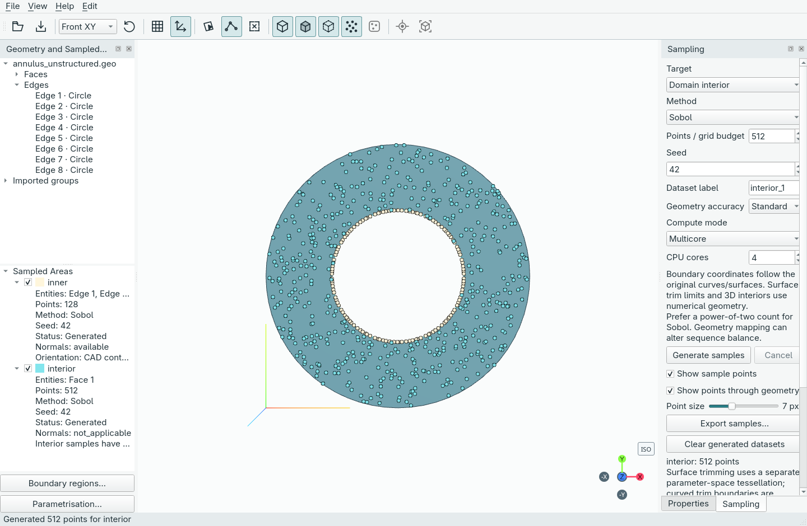

# Jorvik

A desktop GUI for geometry-aware point sampling for PINNs and scientific machine learning.



**Current status:** import Gmsh `.geo`, STEP, OCC BREP or IGES geometry, inspect it in the offline 3D
viewport, and select original faces or edges using separate tools. Includes
synchronized tree selection, multi-selection, imported group information,
dockable panes, a Sampled Areas tree and light/dark themes. Generate labelled datasets with seven
sampling methods, preview interior or boundary coordinates, and export labelled
xarray/NetCDF or NumPy NPZ arrays with applicable outward normals. Create boundary
regions independently of dataset labels, and save full portable projects.

## Quick start

This development preview launches from a checkout with Python 3.12+ and [uv](https://docs.astral.sh/uv/). Once the window opens, use the GUI for the full workflow.

```sh
uv sync --locked
uv run jorvik
```

In the app, choose **File → Open Geometry…**, select faces or edges, create
**Boundary regions…**, then **Generate samples** in the Sampling pane. Use
**File → Save project** to keep an editable `.jorvik` workspace, or **Export
samples…** to save NetCDF/NPZ arrays.

## Documentation

Start with the [illustrated GUI guide](https://praksharma.github.io/Jorvik/guide/getting-started/),
then follow [transforms and sweeps in the GUI](https://praksharma.github.io/Jorvik/guide/transforms-and-sweeps/).
The [full guide](GUIDE.md) includes the same walkthroughs and screenshots.
Optional [Python recipes](GUIDE.md#practical-recipes) cover integration and
training reads. Site preview/build instructions live in the
[documentation workflow](GUIDE.md#documentation-site).

## Intended workflow

Import prepared CAD → label existing edges/faces → sample regions and interior →
export xarray/NetCDF or NumPy NPZ datasets. CAD already contains the required
boundary partitions. Jorvik does not prescribe boundary values or solve PDEs.

Try the reproducible [annulus export example](examples/sample_annulus.py).
See [GUIDE.md](GUIDE.md), [TODO.md](TODO.md), and the original [roadmap](roadmap.txt).
Application shell adapted from PyniteGUI: [attribution](THIRD_PARTY.md).
Licensed under [GNU AGPL v3](LICENSE).
