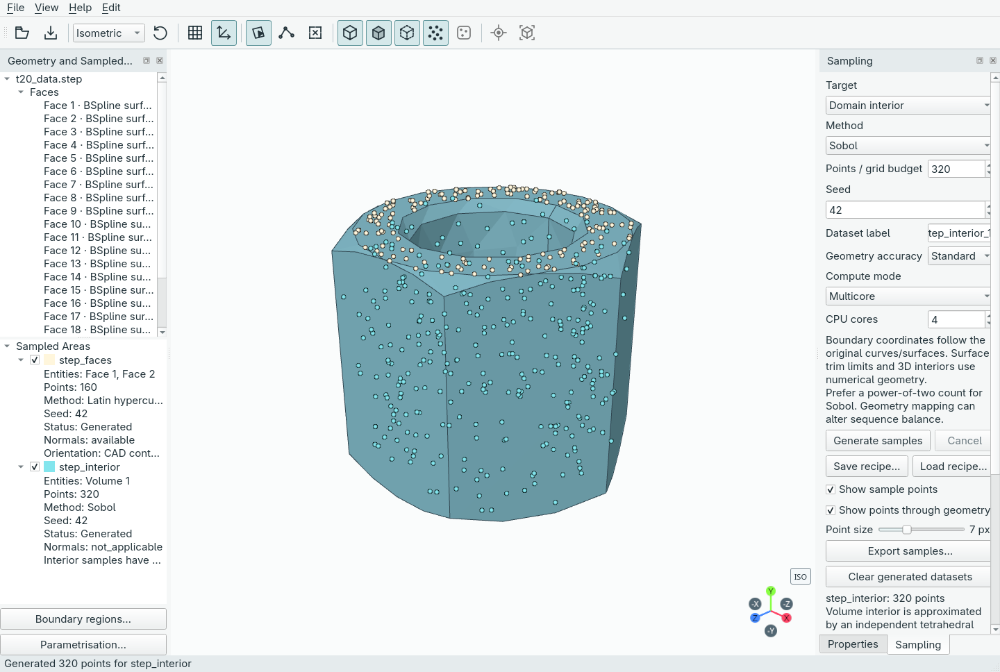

<!-- Generated by scripts/sync_docs.py from GUIDE.md; edit the source. -->

# Geometry import and selection

Open a supported geometry file with File → Open Geometry, or pass its path on the command
line. Import runs outside the UI process; a failed import retains the previous
model. Closing the window stops an active import. File replacement clears old
selections. Face and edge IDs are scoped to the loaded document.

Select faces (F) uses a crosshair cursor; Select edges (E) uses a cell cursor.
Switching modes clears selection. Click selects one entity; Ctrl/Shift-click
toggles additional entities; clicking empty space or Esc clears selection.
Dragging orbits without selecting. The geometry tree can also select entities
and automatically switches to their face/edge mode. Properties shows IDs,
geometry types and imported physical group IDs. Imported groups are read-only.

Hover is teal; selection is orange. Edge hover uses a 4-pixel stroke and
selected edges use a 6-pixel stroke, maintaining their screen width while
zooming. Ordinary edges remain thin. Surface triangles map to original faces;
only original geometry edges participate in edge selection. Edges hidden behind
nearer visible faces cannot be picked. Edge picking uses a fixed six-pixel
screen-space radius with depth tested at the nearest candidate edge point.
Boundary region editing and face hide/isolate controls are available below.
Sampling is available through the Sampling tab; its numerical mesh is separate
from the display tessellation.

Display tessellation follows the source geometry's surface meshing settings;
coarse inputs may look faceted. It is not a sampling accuracy guarantee.

Validation includes asynchronous import of both reference files, face clicks,
annulus hole rejection, edge clicks and multi-selection, tree synchronization,
file replacement, import failure preservation, and drag suppression. The real
Qt WebEngine renderer and QWebChannel bridge are exercised on Wayland.

## Neutral CAD import

New imports and generated datasets record `source_hash`, `source_format` and
`import_options`: the Gmsh version, disabled user configuration loading, and
the loader used. STEP/BREP/IGES also record the explicit format and
`highest_dim_only=false` argument. These describe Jorvik's loader settings;
they do not claim to capture exporter settings or every option inside `.geo`
scripts. Project archives and NetCDF/NPZ metadata retain these records. Older
projects can omit import options; unknown historical settings are not inferred.

Generation rejects changed source content or a changed importer version/settings
when the original import record is available. Reopen the geometry to import it
again: this clears prior regions and datasets, so numeric entity IDs cannot
silently acquire old assignments. Automatic entity remapping and optional
healing remain future work. Main-file hashes do not cover external `.geo`
Include/Merge dependencies.

File → Open Geometry and the command line accept STEP, Open CASCADE BREP and
IGES alongside `.geo`. `cad_import.py` is the shared Qt-independent loader used
by both display and sampling workers. Neutral formats use Gmsh's OCC import and
synchronisation; scripts retain their original kernel. Available CAD entity names
appear in geometry-tree tooltips. Names are not automatically interpreted as BCs
or Gmsh physical groups, and face naming fidelity depends on the source exporter.

The backend model exposes `topology` separately from the face/edge display
`entities`. Each original vertex (dimension 0), edge (1), face (2) and solid (3)
has a document-scoped `(dimension, tag)` identity, CAD type/name, six coordinate
bounds, physical-group memberships, immediate `boundary` references and `upward`
adjacency references. Both adjacency lists contain `[dimension, tag]` pairs;
orientation is not encoded and must not be used to infer outward normals.
Construction vertices and degenerate edges remain in this model even if they
have no visible primitives. Topology contains no display triangles and is not an
editable or standalone exact-geometry representation; geometric evaluation still
uses the source CAD through Gmsh. Numeric tags are not stable across reimports.

Both built-in and Open CASCADE `.geo` scripts retain their kernels. Regression
checks construct the same cube in each kernel and verify original entity counts,
adjacency, physical groups and edge/face/interior sampling. STEP/BREP/IGES fixtures
also expose this topology. Projects preserve it and reject inconsistent entity
references, adjacency or bounds before replacing the workspace. Older projects
without topology remain readable; reopen the source to populate the new model.

Interior domains are explicitly classified as `solid`, `planar` or
`open_or_nonplanar`. A `.geo` file without volumes qualifies for 2D interior
sampling only when its faces are recognized analytic planes lying in one plane.
An open sphere, a non-planar shell or disconnected planes at different heights
cannot silently become a 2D interior dataset. Unsupported planar NURBS domains
are conservatively rejected until their planarity can be verified. Boundary
sampling remains available. Declared solid meshing failures identify open
boundaries/invalid topology instead of replacing existing sampled datasets.

Files containing faces but no solid volumes can be displayed and sampled on faces
and edges. Neutral-format interior sampling requires imported solid volumes and
reports a clear error for surface-only files. No automatic sewing is introduced
in this importer. This deliberately does not treat a set of cube-shaped surfaces
as a solid merely because it looks closed. Source units remain unspecified in
exports; unit detection/conversion, comprehensive assembly metadata and optional
healing remain roadmap work. Display topology retains zero-length CAD edges with
an explanatory tooltip, omits their rendering and rejects sampling them.

Try the downloaded fixtures under `examples/geometries/cad/`: `t20_data.step`
(a solid supporting interior sampling), `cylinder.brep` (curved solid),
`cube_filet.stp` (filleted surfaces with degenerate edges), and `cube1000.igs`
(surface-only cube). README, provenance.json and LICENSE.txt record pinned
upstream sources, checksums and licensing. They are not converted `.geo` files.

STEP/BREP/IGES support is validated on these small fixtures; industrial CAD,
assemblies, additional STEP application protocols, units, healing and stable
cross-import region identifiers still require broader testing. No STL, Parasolid,
ACIS or proprietary native CAD importer is added.
