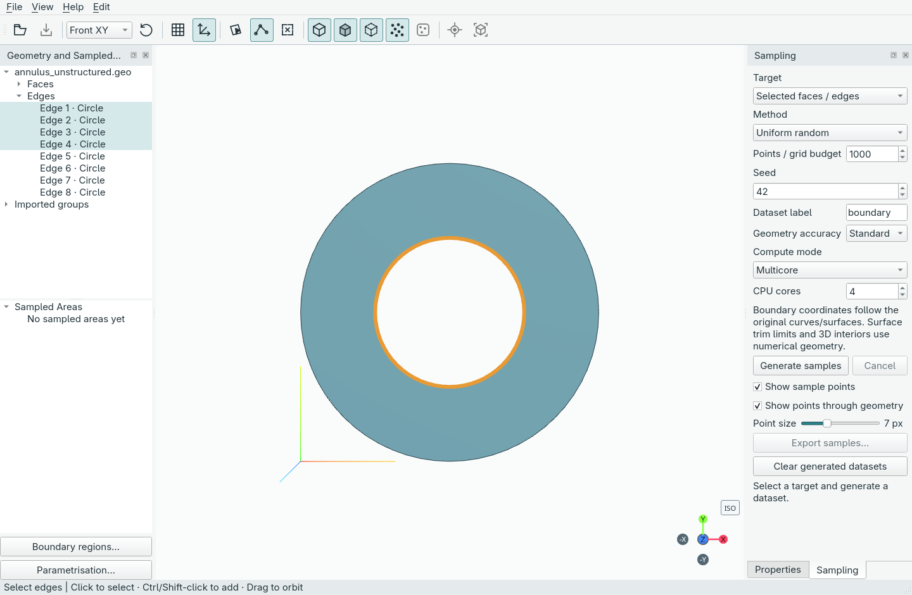
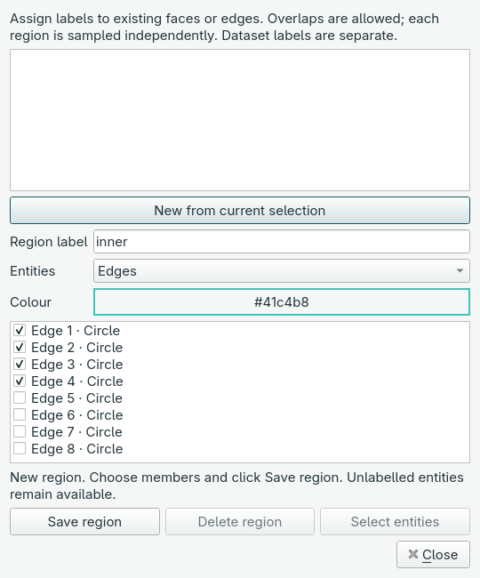
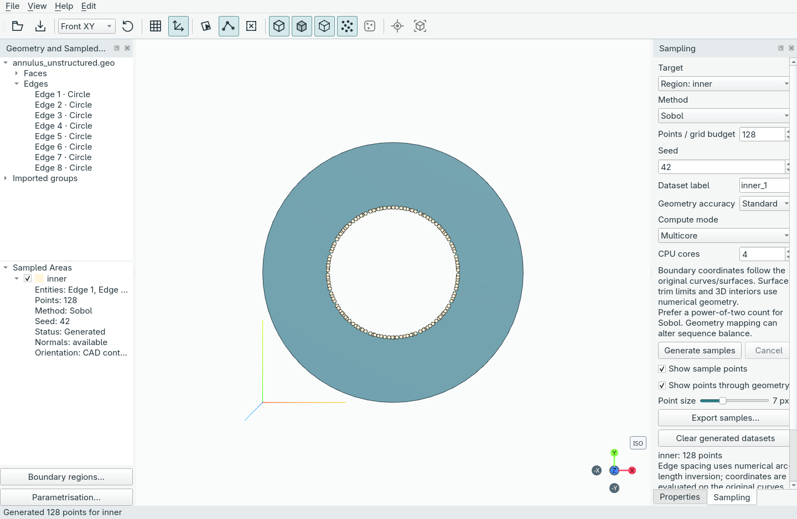
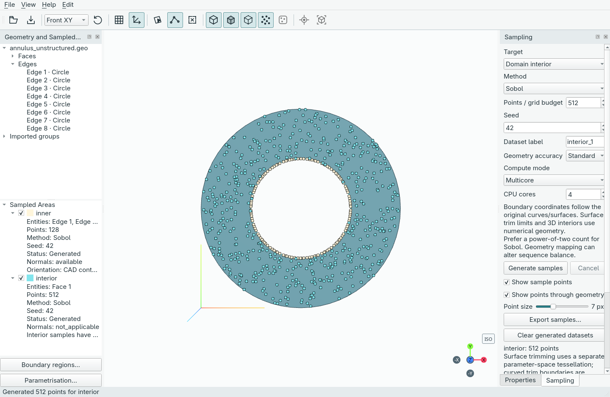
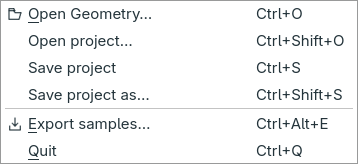

<!-- Generated by scripts/sync_docs.py from GUIDE.md; edit the source. -->

# Your first dataset in the GUI

Jorvik is a desktop application. You select geometry, name regions, generate
points and save or export using the windows and buttons shown below. Commands
and Python are optional integration/development tools, covered separately.

These are screenshots of the real app in its light theme. The example uses
`annulus_unstructured.geo` from `examples/geometries/cfdbench` in the checkout.
Once Jorvik is open, the whole workflow below uses the GUI. If you have not
installed it yet, see **Installing and launching Jorvik**.

## 1. Open geometry and find your way around

Choose **File → Open Geometry…** and select the annulus file. Choose **Front XY**
from the camera selector to look straight at the ring. The geometry tree is on
the left, the interactive viewport in the centre, and **Sampling** on the right.
The lower-left **Sampled Areas** tree will hold your generated datasets.

Click **Edges** in the toolbar (or press `E`), then select the four inner arcs.
Ctrl/Shift-click adds to the selection; the corresponding tree entries highlight.
You can select the edges in the tree too. The edge numbers in these pictures
belong to this particular annulus; inspect other models before choosing theirs.

## 2. Name a boundary region

Click **Boundary regions…** below the left-hand trees. Enter `inner` as the
**Region label**, confirm that **Edges** is selected and the four inner arcs are
checked, then click **Save region** and **Close**.

A region groups existing faces or edges under a name. It does not cut the CAD or
assign a physical boundary-condition value. Dataset labels are separate: they
name the generated point clouds.

## 3. Generate boundary points

In the right-hand **Sampling** pane:

1. Choose **Target → Region: inner**.
2. Choose **Method → Sobol**.
3. Set **Points / grid budget** to **128** and **Seed** to **42**.
4. Enter `inner` as the **Dataset label**, then click **Generate samples**.

The new `inner` dataset appears under **Sampled Areas**, with its point count,
method, seed and normal availability. Its checkbox controls visibility. The
label field advances to the next available name after generation; it does not
rename the dataset you just created.

## 4. Add interior points and inspect both datasets

Change **Target** to **Domain interior**, set the count to **512**, enter
`interior` as the label and click **Generate samples** again. The boundary points
remain, and a separate cloud fills the annulus without filling its hole.

Use the dataset checkboxes to compare clouds, and **Point size** to adjust their
markers. Left-drag orbits, right-drag pans and scrolling zooms. Right-click a
dataset for editing, duplication or deletion; **Edit → Undo** restores supported
edits. Boundary normals are shown as available when their orientation was checked;
interior samples have no outward boundary normal.

## 5. Save your workspace or export the points

Choose **File → Save project** (`Ctrl+S`) and save a `.jorvik` document to continue
editing later. Choose **File → Open project…** to reopen it. Projects preserve
geometry, regions, generated datasets and workspace settings.

Choose **Export samples…** in the Sampling pane, or **File → Export samples…**,
to save **NetCDF (.nc)** or **NumPy (.npz)** data for downstream work. All generated
datasets are exported, including clouds whose preview is hidden.

Save a project to keep an editable workspace; export samples to use the arrays
in another tool. Each label keeps its own point count. Neither operation requires
writing Python or running a terminal command.
