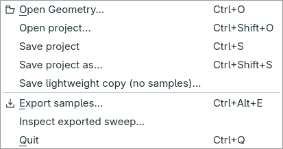
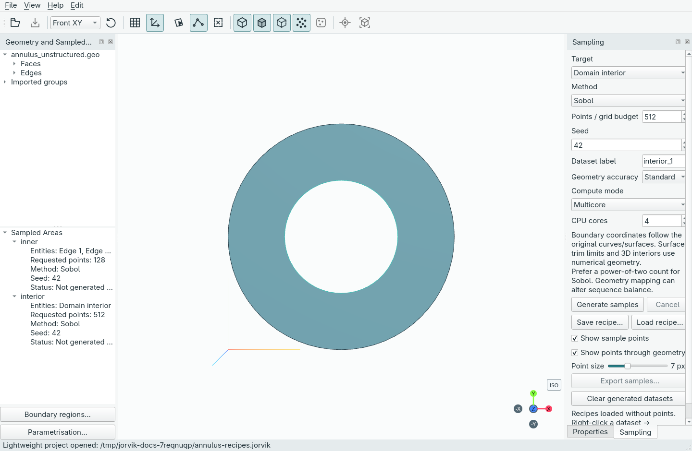
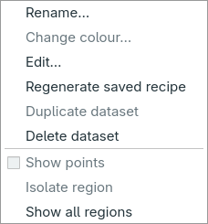
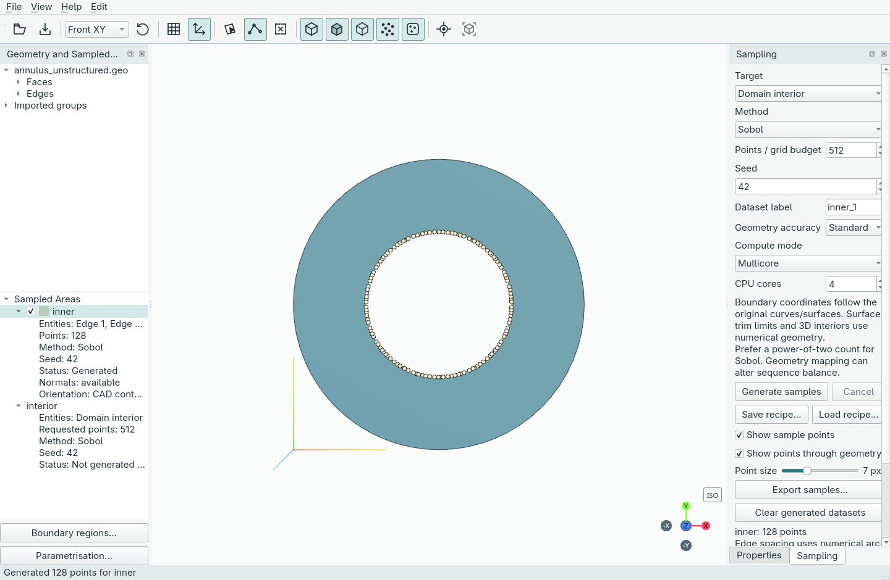

<!-- Generated by scripts/sync_docs.py from GUIDE.md; edit the source. -->

# Projects and recovery

Use **File → Save project** (`Ctrl+S`) to save the current workspace, or
**File → Open project…** (`Ctrl+Shift+O`) to reopen an existing document. To start
from CAD, choose **File → Open Geometry…**. Invalid files produce an error and
do not replace the workspace with partially loaded data.

New project documents use `.jorvik`. Existing `.gsproj` files remain supported by
the creation API, command line, Open project dialog and recovery workflow. The
archive format and schema are unchanged: only the preferred filename extension
has changed. Saving an opened legacy file keeps its `.gsproj` filename; Save As
suggests `.jorvik` and leaves the old file intact. No files are automatically
renamed. External applications should create new documents with `.jorvik`.

A `.jorvik` can be empty. File → Save project saves the normal empty workspace;
opening an empty document leaves it ready for geometry import. Import geometry,
then Save to update that same document without choosing a filename again. The
import counts as an unsaved edit, including when closing immediately afterward.

## Saving and opening

Use **File → Save project** (`Ctrl+S`) or **Save project as…** (`Ctrl+Shift+S`)
to write a `.jorvik` archive. **Open project…** (`Ctrl+Shift+O`) restores it;
**Open Geometry** remains `Ctrl+O`. Dataset export is now `Ctrl+Alt+E`.
Saving/opening is unavailable during import, generation or an active parametrisation
workspace; close that workspace first to keep transient previews out of projects.

## Save a lightweight copy without points

Choose **File → Save lightweight copy (no samples)…** and select a different
`.jorvik` filename. This saves the embedded main CAD source, cached geometry,
boundary regions, sampling recipes, colours, controls and transform/design setup,
while omitting generated coordinates, entity-tag arrays and normal arrays.
The current open project and its point clouds stay unchanged. Saving this copy
does not switch documents, mark your current changes saved, or clear recovery.
The current project filename cannot be chosen as the lightweight destination.

Open the copy with **File → Open project…**. Its datasets are listed as
**Not generated (samples omitted)** with their requested point counts. No sampling
runs when the file opens; cached CAD remains available for inspection.

Right-click a dataset and choose **Regenerate saved recipe** to generate it using
its recorded target, method, requested count/grid budget, seed, geometry accuracy
and compute settings. It ignores unrelated current Sampling controls. Recorded
region snapshots are retained, even if a live region definition was edited later.
Use **Edit…** instead when you intentionally want to change the recipe first.

Regeneration replaces only that entry after success. Cancellation/failure leaves
the pending recipe or previous samples intact, and Undo/Redo can restore the
previous state. Recreate the other required datasets before transform previews
or sweep processing. Their saved definitions remain in the project.

After regeneration, **Save project** saves the generated points into this opened
copy using the normal format; the original full project remains separate.
Lightweight copies use the existing populated-project schema **2**, with a
`samples_omitted: true` marker and explicit not-generated recipes. Geometry-free
projects remain schema **3**. Normal saves and older project loading are unchanged.

This can reduce file size and avoids converting point buffers during the copy,
but cached geometry still consumes space. Dataset isolation is cleared because
there are no point clouds to isolate. A fixed seed does not guarantee identical
coordinates across changed mesher/library versions. The main `.geo` file is
embedded; full external Include/Merge dependency bundling remains future work.

## Unsaved changes

Changes to datasets, boundary assignments, sampling settings and parametrisation
setups prompt **Save / Discard / Cancel** before replacing the workspace or
closing. Cancel leaves the current workspace open. Save must complete successfully
before replacement proceeds; cancelling Save As, changed CAD, invalid data or a
failed disk write cancels the original replacement/close. Failed imports are
validated before a replacement prompt, retaining the current workspace. Ordinary
camera/selection navigation does not make a project dirty. Dataset visibility and
colour changes do count as content changes.

## Background file operations

Archive reads/writes, validation and content fingerprints use one background
worker while Qt keeps processing events. Editing and replacement controls are
locked during the operation; the viewport remains interactive and an indeterminate
progress indicator shows file work. Worker errors restore the controls and retain
existing destinations. Viewport serialisation/restoration can still be expensive
for large clouds and has not been certified responsive at one million points.

## Recovery copies

Every two minutes, an idle dirty workspace writes an atomic recovery copy in the
application data `recovery` directory (beside settings for explicit INI profiles).
Unchanged copies are skipped. Autosave never changes the normal project path,
marks the workspace saved, regenerates geometry, or overwrites the user's project.
Source/hash failures retain the previous recovery copy and show a status message.
Active import/generation, editors and project jobs postpone recovery writes.

## Recover an interrupted session

On startup, abandoned copies offer Recover, Discard or Cancel. Lock files prevent
a live window's copy being offered by another window. Recovery loads validated
cached geometry/data, keeps the workspace dirty and requires **Save As** to choose
a destination; it never silently overwrites an original project. A recovered copy
is transferred to the new window before the old copy is deleted. Successful manual
saving or explicit discard/clean close removes that window's recovery copy;
cancelling close retains it. The two-minute interval means very recent edits can
still be lost on interruption. External `.geo` dependencies remain outside the
embedded main-source recovery guarantee.

## Measured archive performance

Persistence measurements on the validation host (fresh process per size):

| Points | Save | Load | Archive | Peak process RSS |
| --- | --- | --- | --- | --- |
| 100,000 | 0.112 s | 0.050 s | 3.19 MiB | 201.30 MiB |
| 1,000,000 | 1.099 s | 0.417 s | 31.70 MiB | 1123.52 MiB |

Run `uv run python tools/benchmark_projects.py --count 1000000` to repeat.
This synthetic analytic annulus benchmark verifies exact coordinates, entity tags
and normals. Peak RSS includes original and restored list-based clouds, scientific
libraries and verification arrays. It measures backend archive persistence, not
geometry generation or viewport rendering; these figures are not UI latency or
cross-machine guarantees. Reducing numeric/list copies remains open work.

## What a project stores

Projects contain the main CAD source, cached display topology, original generated
coordinates and entity tags, generated/failed region records, sampling recipes,
colours, per-region/global visibility, individual face filters, CAD selection,
point appearance, camera, dock layout and the current transform/design setup. Geometry
and coordinate arrays use compressed numeric storage rather than large JSON lists
on disk, and load without pickle. Opening restores cached samples and display
without CAD execution, remeshing or regeneration. Writes use atomic replacement;
invalid versions, checksums or content are rejected before replacing the workspace.
Save explicitly after editing to update the project file; periodic recovery copies are separate from manual saves.

## Moved or changed CAD sources

The project uses the original CAD path if it still matches the saved hash.
Otherwise it restores the embedded source into an application-managed temporary
folder for subsequent sampling, and keeps it alive until the project is replaced
or the application closes. Loading the project again does not require that folder
to survive. Source geometry changes are not silently applied to saved entity IDs.
The archive embeds only the main source: `.geo` files using external Include/Merge
files still need those dependencies for regeneration. Their saved display and
samples can be inspected/exported without the dependencies. Packaging and hashing
complete `.geo` dependency graphs remains future work.
