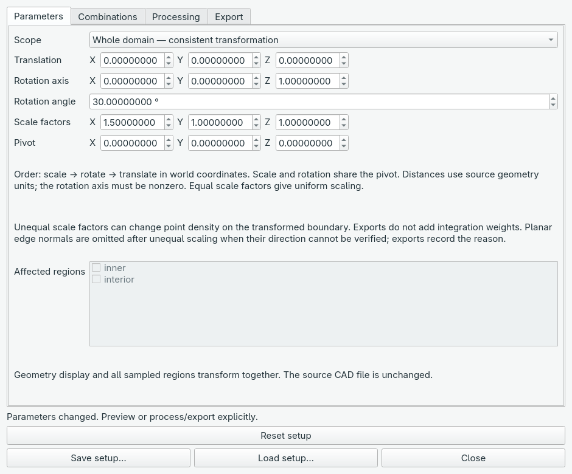
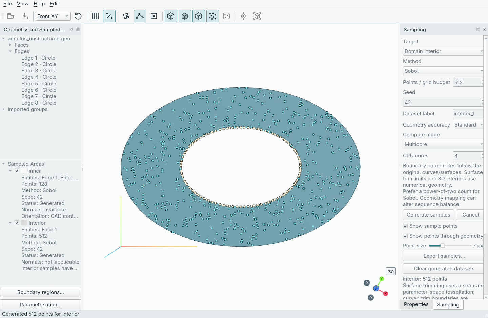
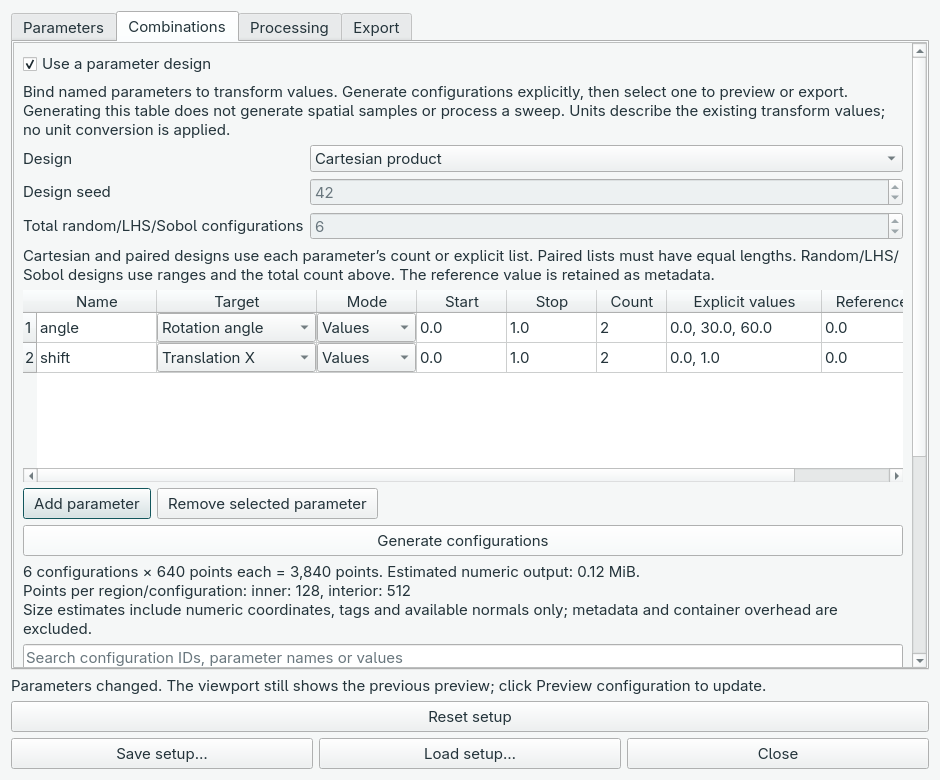
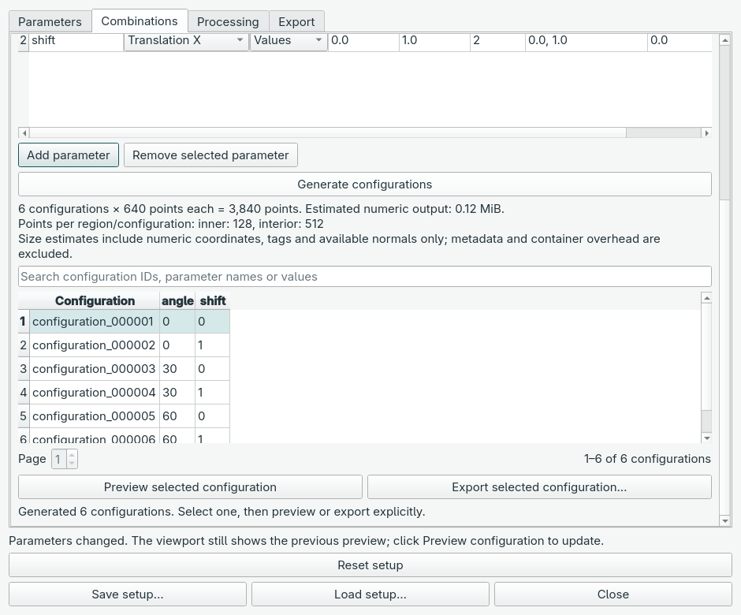
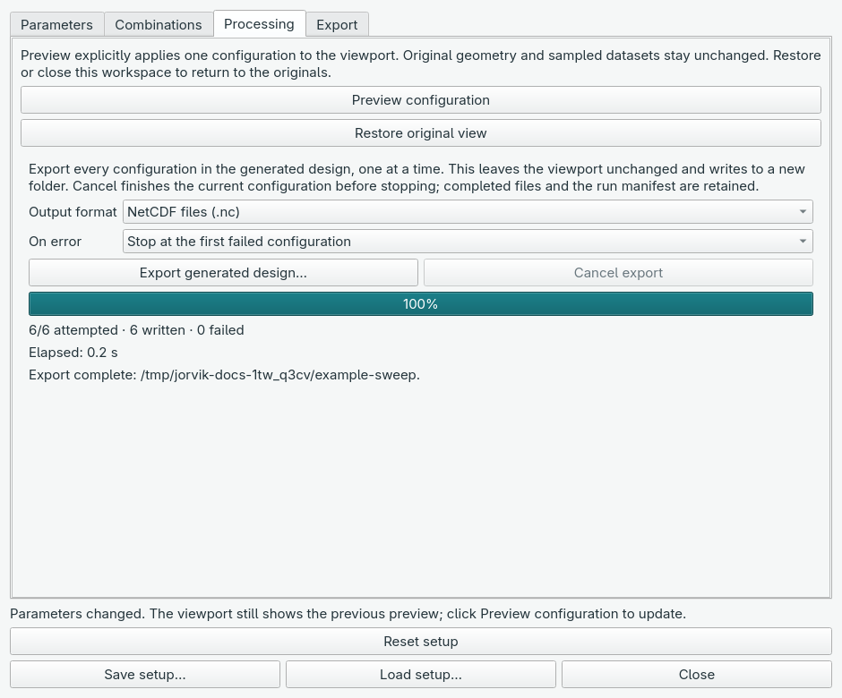

<!-- Generated by scripts/sync_docs.py from GUIDE.md; edit the source. -->

# Transforms and sweeps in the GUI

Start with generated datasets in **Sampled Areas**, then click
**Parametrisation…** below that tree. The tabs guide you through setting values,
creating combinations, previewing and exporting. This walkthrough continues with
the annulus's `inner` and `interior` datasets from **Your first dataset in the GUI**.

## 1. Set a transform

On **Parameters**, keep **Whole domain — consistent transformation** selected.
Set X **Scale factors** to **1.5** and the **Rotation angle** to **30°**, leaving
the Z rotation axis and other scale factors unchanged. Translation and pivot
fields are available in the same tab.

The order is scale, rotate, then translate. Scale and rotation share the pivot.
Whole-domain mode transforms the geometry display and all sampled clouds together.
Selected-region mode moves only checked clouds, with unverified domain consistency.
Distances retain the CAD source units; no unit conversion is inferred.

## 2. Preview and restore

Open **Processing** and click **Preview configuration**. The annulus display and
samples become a rotated ellipse. Editing fields alone does not update the view;
click Preview again when you want to inspect new values. You can move the dialog
aside to see the viewport.

Click **Restore original view** to remove the preview while keeping your values.
Closing the workspace also clears the preview. **Reset setup** resets both the
values and display to the original configuration. Transforms use the original
samples every time; they do not regenerate CAD or resample the domain.

For a single output, use **Export → Process configuration and export…** and
choose NetCDF or NPZ. The saved file contains transformed points and provenance;
the original samples remain in the project.

## 3. Make several configurations

Open **Combinations**, check **Use a parameter design**, and use **Add parameter**
for each named value. For the six-row example pictured here, choose
**Cartesian product** and enter:

| Name | Target | Mode | Explicit values |
| --- | --- | --- | --- |
| angle | Rotation angle | Values | `0, 30, 60` |
| shift | Translation X | Values | `0, 1` |

The summary shows **6 configurations × 640 points each = 3,840 points** for this
example. The original clouds contain 128 boundary points and 512 interior points;
those counts remain independent in every configuration. The disabled total-random
count does not control Cartesian products; each parameter's list does.

Click **Generate configurations**, then scroll down to the table. Select a row
and click **Preview selected configuration** to inspect it. Selection alone does
not change the viewport. **Export selected configuration…** exports just that row.

Search by configuration ID, parameter name or value to find rows. Searching only
filters the table; it does not reduce a full sweep export. If you edit a transform
or design definition, generate the configurations again before using them.

## 4. Export the whole design

Open **Processing**. Choose **Output format** and the **On error** policy, then
click **Export generated design…** and choose a new output-folder name.
This processes every generated configuration in the design.

Progress reports attempted, written and failed configurations, plus elapsed time.
**Cancel export** finishes the current file and stops before the next. Completed
files remain available. A successful run shows **6/6 attempted · 6 written ·
0 failed**, as above. Partial and failed runs retain their status and error records;
resume/retry is not yet available.

Save the project to retain your transform and design definitions. Reopening the
project restores the definitions; click **Generate configurations** again to
rebuild the table. For Python consumers, the separate code recipes explain how
to verify exported files and read one configuration at a time.
