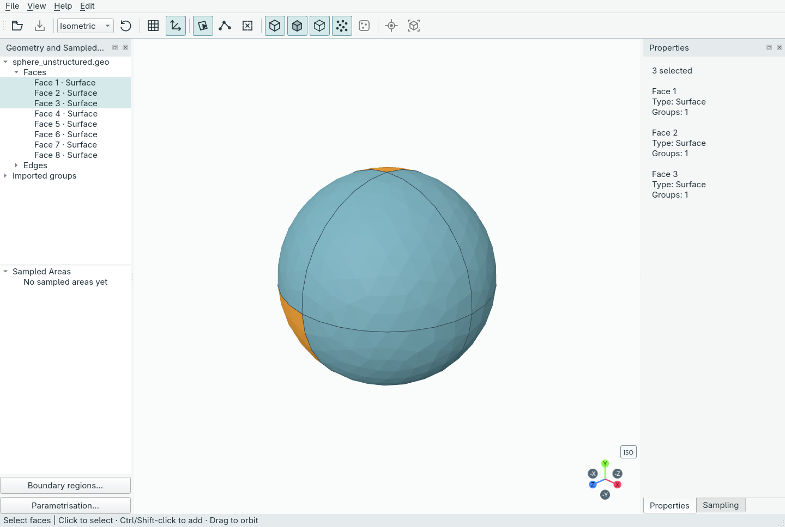
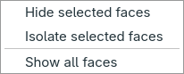
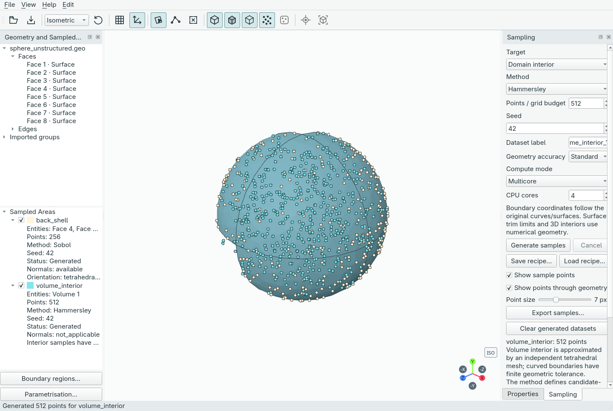
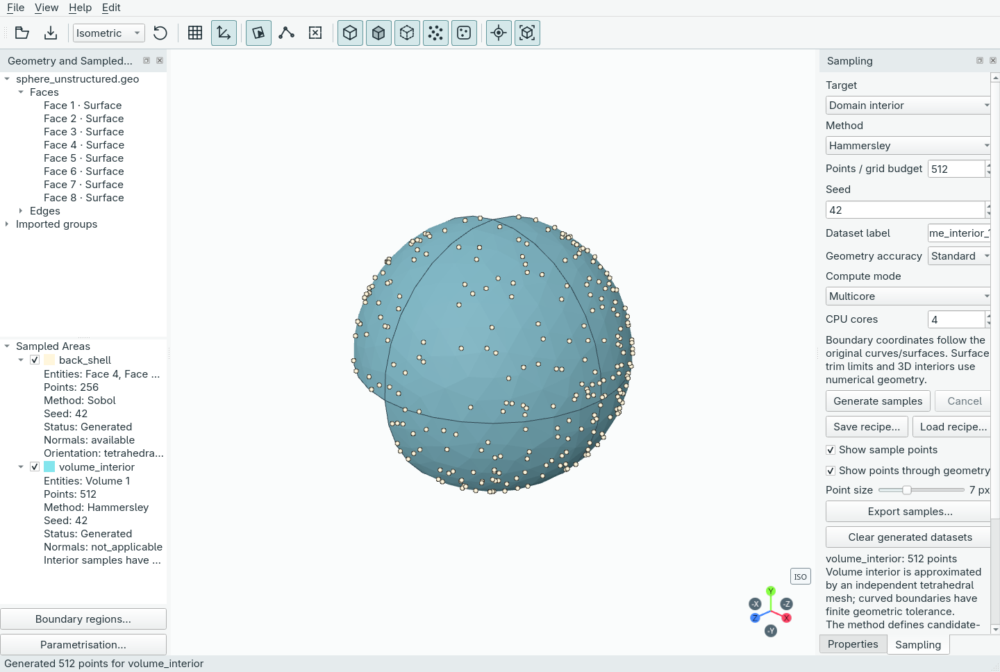
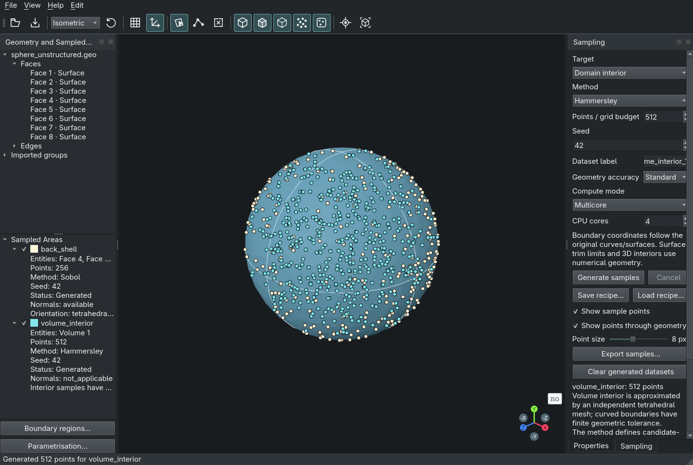

<!-- Generated by scripts/sync_docs.py from GUIDE.md; edit the source. -->

# Tutorial: 3D sphere cutaway and volume sampling

This tutorial walks through a complete 3D boundary and tetrahedral volume sampling
workflow in the GUI using `examples/geometries/cfdbench/sphere_unstructured.geo`.
You will select curved 3D surface patches, hide front faces to create an interior
cutaway view, sample both the exterior shell and the 3D volume interior using
multicore meshing, isolate a single dataset with its geometric context, and
switch between light and dark themes.

## 1. Open the 3D sphere and inspect surface patches

Choose **File → Open Geometry…** and select
`examples/geometries/cfdbench/sphere_unstructured.geo`. Ensure the camera selector
in the top toolbar is set to **Isometric** and click **Select faces** (`F`).
Click **Face 1**, then hold `Ctrl` (or `Shift`) and click **Face 2** and **Face 3**
in the 3D viewport (or in the **Faces** branch of the left-hand geometry tree).
Switch to the **Properties** tab on the right dock to inspect the selected surface
patches and their imported physical group memberships.

Each octant of the sphere is a single selectable CAD face regardless of how many
display triangles Gmsh used to render it. Hovering over unselected faces highlights
them in teal; selected faces appear in orange.

## 2. Hide front faces to create a 3D cutaway view

When working with closed 3D solids, front surfaces can obscure interior point
clouds. Right-click any of the selected faces in the left-hand **Geometry** tree
to open the face visibility context menu, then click **Hide selected faces**.

Hiding faces removes only their shaded triangles from the 3D viewport so you can
peer directly inside the hollow shell. Original CAD edges remain visible unless
you toggle **Edges** off in the toolbar, and hidden faces remain selectable in the
tree at any time.

## 3. Sample the curved boundary and 3D tetrahedral interior

Select the five remaining visible back-shell faces (**Face 4** through **Face 8**)
in the tree or viewport, switch to the **Sampling** tab on the right dock, and
generate a curved surface dataset:

1. Set **Target** to **Selected faces / edges**.
2. Choose **Method → Sobol**, set **Points / grid budget** to **256**, and **Seed** to **42**.
3. Enter `back_shell` as the **Dataset label** and click **Generate samples**.

Next, sample the 3D solid interior without clearing the surface points:

1. Change **Target** to **Domain interior**.
2. Choose **Method → Hammersley** and set **Points / grid budget** to **512**.
3. Keep **Compute mode → Multicore** (which uses Gmsh's parallel 3D HXT tetrahedral mesher).
4. Enter `volume_interior` as the **Dataset label** and click **Generate samples**.

Because **Show points through geometry** is checked in the Sampling pane, interior
points remain visible even behind shaded surfaces. Under **Sampled Areas**, notice
that `back_shell` reports `Normals: available` (verified via tetrahedral containment
probes on the built-in Gmsh volume), whereas `volume_interior` reports
`Normals: not_applicable` because interior volume points have no outward boundary normal.

## 4. Isolate a single dataset with its CAD geometry context

When a project accumulates several boundary and interior datasets, you can focus
on one dataset at a time without losing or hiding the others permanently:

1. Click `back_shell` in the **Sampled Areas** tree.
2. Click **Isolate region** in the top toolbar (or right-click `back_shell` → **Isolate region**).
3. Click **Geometry in isolation** beside it in the toolbar to display only the
   CAD faces and boundary edges belonging to `back_shell`.

Toggling **Isolate region** off immediately restores your previous face visibility
and shows all checked datasets again. Isolation is purely a display filter:
**Export samples…** always exports every generated dataset in the workspace.

## 5. Switch to the dark theme and tune point markers

Choose **View → Appearance → Dark** from the menu bar and drag the **Point size**
slider in the **Sampling** pane to **8 px**. Click **Show all faces** in the
geometry tree context menu to restore the complete sphere.

Every sample marker is rendered with a high-contrast dark rim around a coloured
disc so points remain legible against both light and dark canvases as well as
orange selection highlights. Your chosen theme and marker size persist
automatically across application launches.
