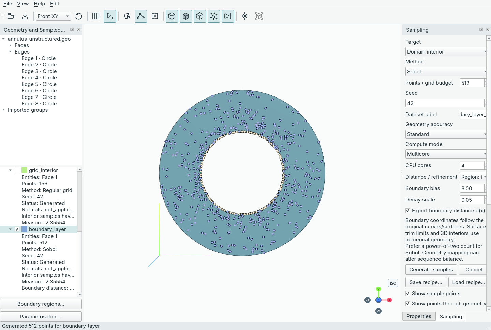
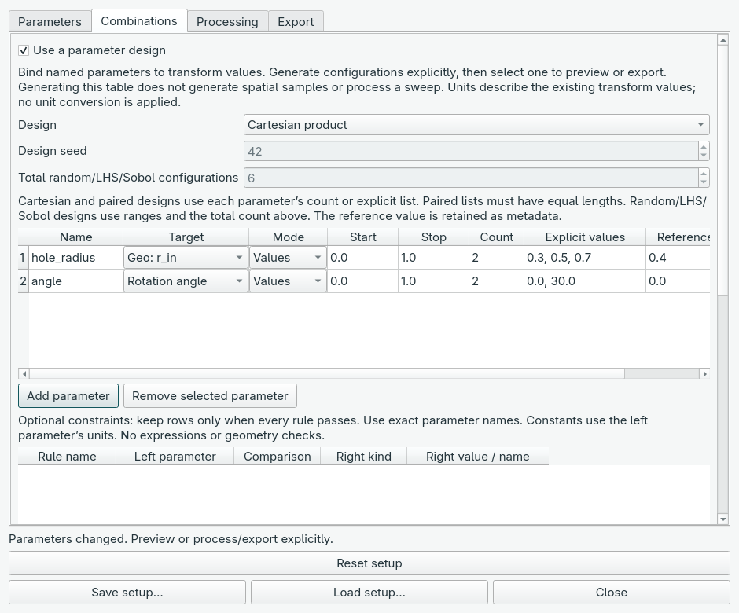
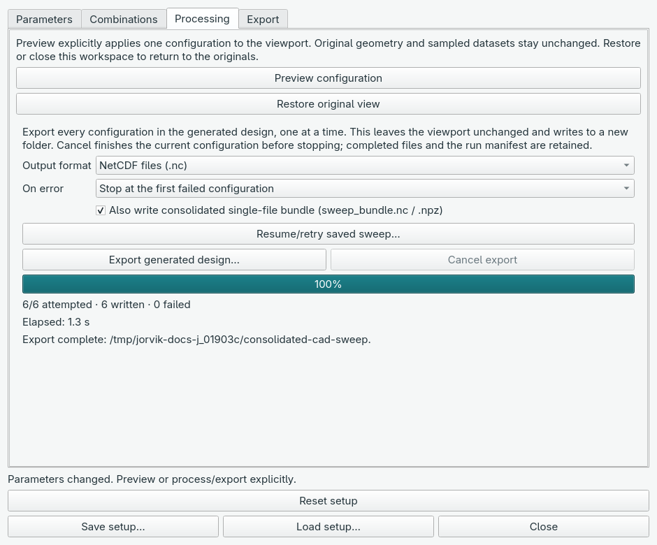

<!-- Generated by scripts/sync_docs.py from GUIDE.md; edit the source. -->

# Tutorial: Quadrature weights, boundary-distance refinement and CAD regeneration sweeps

Many scientific machine learning architectures—including Deep Ritz, VPINNs,
weak-form neural operators, hard-constrained boundary networks, and parametric
shape-optimization surrogates—require more than uniform collocation coordinates.
Jorvik provides five integrated capabilities for these workflows:

1. **Per-point quadrature / measure weights (`weights`)** summing to the exact
   1D length, 2D surface area, or 3D volume (`domain_measure`), with exact affine
   Jacobian weight transport under anisotropic scaling and rotation.
2. **Unsigned boundary-distance fields ($d(\mathbf{x})$, `boundary_distances`)**
   and **distance-biased spatial refinement** toward user-selected walls, inlets,
   or obstacles, with automatic importance-sampling weight correction.
3. **Topological dimensional CAD regeneration sweeps** over top-level numeric
   parameters discovered automatically in `.geo` scripts (`Geo: <name>` targets).
4. **STEP/IGES coordinate unit detection (`coordinate_units`)** and **multi-volume
   3D subdomain targets** (`Volumes` and 3D `Physical Volume` groups).
5. **`xarray.DataTree` representation (`to_datatree`)** and single-file
   **consolidated sweep bundles (`sweep_bundle.nc` / `sweep_bundle.npz`)**.

## 1. Concentrate interior collocation points near a boundary and export $d(\mathbf{x})$

Suppose you are solving a boundary-layer problem on the 2D annulus
(`examples/geometries/cfdbench/annulus_unstructured.geo`) where steep gradients
occur near the inner circular wall ($r = 0.5$), and you also need the exact
unsigned distance $d(\mathbf{x}) = \min_{\mathbf{y} \in \Gamma_{\text{inner}}} \|\mathbf{x} - \mathbf{y}\|_2$
for a hard Dirichlet boundary ansatz $\hat{u}(\mathbf{x}) = g(\mathbf{x}) + d(\mathbf{x})\,\mathcal{N}_\theta(\mathbf{x})$:

1. Create or select the `inner` boundary region (`Edge 1` through `Edge 4`, radius $r = 0.5$).
2. In the **Sampling** pane, set **Target** to **Domain interior**, **Method** to **Sobol**,
   and **Points / grid budget** to **512**.
3. Set **Distance / refinement** to **Region: inner** (or the imported `inner (edges)` group).
4. Set **Boundary bias** ($\alpha$) to **6.0**, **Decay scale** ($\sigma / L$) to **0.05**,
   keep **Export boundary distance d(x)** checked, enter label `boundary_layer`, and click **Generate samples**.



Jorvik evaluates the exact Euclidean distance $d(\mathbf{x})$ from candidate interior
points to the reference boundary curves, performs exact acceptance-rejection against
the unnormalized target density $\rho(\mathbf{x}) = 1 + \alpha \exp(-d(\mathbf{x}) / \sigma)$,
and importance-corrects the per-point quadrature weights:

$$w_i = |\Omega|\,\frac{1 / \rho(\mathbf{x}_i)}{\sum_{j=1}^N 1 / \rho(\mathbf{x}_j)}, \qquad \sum_{i=1}^N w_i = |\Omega| \approx \pi(1^2 - 0.5^2) \approx 2.35619.$$

Because the weights are importance-corrected by $1/\rho(\mathbf{x}_i)$, Monte Carlo
quadrature $\sum_{i=1}^N w_i\,\mathcal{L}(\mathbf{x}_i)$ remains an unbiased estimator
of $\int_\Omega \mathcal{L}(\mathbf{x})\,d\Omega$ even when points are concentrated
near the wall. Setting **Boundary bias** to `0.0` keeps uniform spatial sampling
while still computing and exporting `boundary_distances`.

## 2. Sweep true CAD feature dimensions in `.geo` scripts

Affine scaling stretches an entire domain simultaneously, turning circular holes
into ellipses. When you instead want to vary an internal geometric feature—such as
changing the inner hole radius `r_in` while keeping the outer boundary circular at
`r_out = 1.0`—Jorvik discovers top-level numeric variables in `.geo` scripts
automatically on import (`geometry["geo_parameters"]`) and exposes them as
**Geo: &lt;name&gt;** targets in **Parametrisation → Combinations**:

1. Open a parametric `.geo` script containing top-level scalar assignments such as
   `r_in = 0.4;` and `r_out = 1.0;`, and generate your boundary and interior datasets.
2. Click **Parametrisation…** and switch to the **Combinations** tab.
3. Check **Use a parameter design**, click **Add parameter**, and select
   **Geo: r_in** (`geo:r_in`) in the **Target** column.
4. Set **Mode** to **Values**, enter `0.3, 0.5, 0.7`, optionally add an affine
   parameter such as `angle` (**Rotation angle**), and click **Generate configurations**.



When you preview or export a configuration that includes `Geo: <name>` parameters:

- Jorvik substitutes the overridden scalar values into the `.geo` script in an
  isolated temporary workspace without modifying your original `.geo` file on disk.
- It verifies that the regenerated CAD topology (all 1D/2D/3D entity tags and
  physical groups) matches the base geometry; if a parameter combination collapses
  a face or changes entity topology, Jorvik rejects that configuration with a clear
  topological error.
- It re-runs each dataset's saved sampling recipe (including boundary normals,
  measure weights, and boundary distances) on the regenerated CAD model, then
  applies any composed affine transformation (scale, rotation, translation).

## 3. Export a single-file consolidated sweep bundle and load it as an `xarray.DataTree`

On the **Processing** tab of **Parametrisation**, check
**Also write consolidated single-file bundle (sweep_bundle.nc / .npz)** before
clicking **Export generated design…**.



Alongside the individual `configuration_000001.nc` shards and `manifest.json`,
Jorvik writes an atomic `sweep_bundle.nc` (or `sweep_bundle.npz`) file and records
its SHA-256 checksum in `manifest.json`. You can load either the sweep folder or
the single-file bundle directly into a hierarchical `xarray.DataTree`:

```python
from jorvik.sweep_container import to_datatree, load_consolidated_sweep

# Load directly from the sweep folder or from sweep_bundle.nc / sweep_bundle.npz
tree = to_datatree("parameter_sweep", require_integrity=True)
bundle_tree = load_consolidated_sweep("parameter_sweep/sweep_bundle.nc")

# 1. Inspect parameter values across all configurations: shape (C, P)
hole_radii = tree["parameters"].ds["hole_radius"].values

# 2. Access stacked region tensors: coordinates (C, N, 3), weights (C, N), normals (C, N, 3)
inner_ds = tree["regions/inner"].ds
coords = inner_ds["coordinates"].values      # (C, N_inner, 3)
weights = inner_ds["weights"].values         # (C, N_inner)
normals = inner_ds["normals"].values         # (C, N_inner, 3)
```

If a `.geo` regeneration sweep uses **Regular grid** sampling and produces varying
point counts across configurations (`uniform_counts == 0`), `to_datatree` and
`load_consolidated_sweep` automatically organize the tree without padding or
truncation under `/configurations/<configuration_id>/regions/<safe_key>`.
