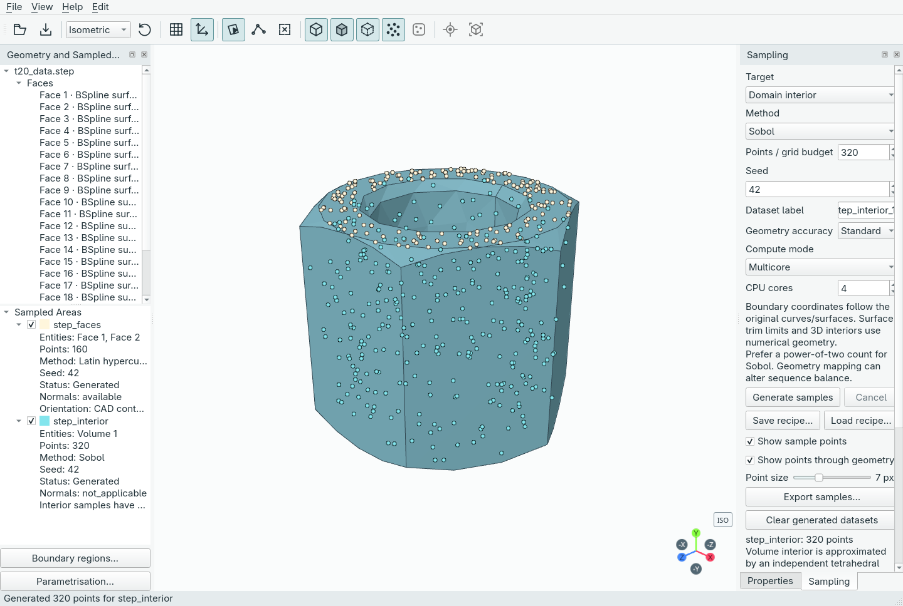
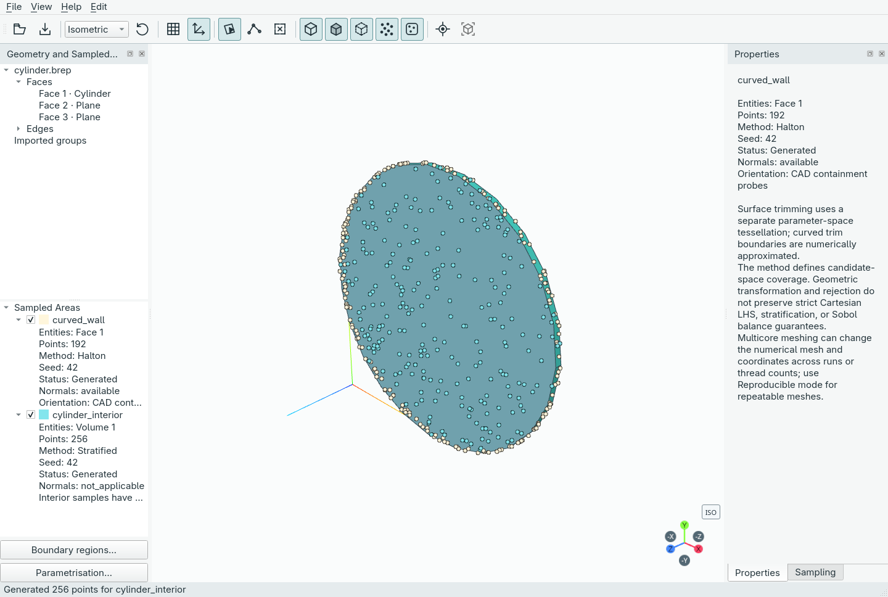
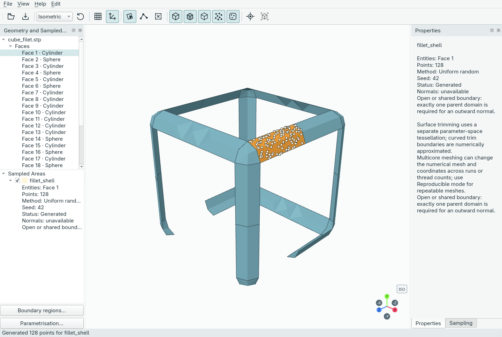

<!-- Generated by scripts/sync_docs.py from GUIDE.md; edit the source. -->

# Tutorial: Neutral CAD workflows with STEP and BREP

In realistic scientific ML pipelines, geometries often originate in mechanical CAD
systems and are exchanged as neutral **STEP** (`.step`, `.stp`), **Open CASCADE BREP**
(`.brep`), or **IGES** (`.iges`, `.igs`) files. This tutorial demonstrates how
Jorvik imports topology-preserving neutral CAD fixtures from
`examples/geometries/cad/`, verifies outward normals on curved solids, and detects
open surface shells and degenerate edges.

## 1. Sample a 3D STEP solid with curved B-spline faces

Choose **File → Open Geometry…** and select `examples/geometries/cad/t20_data.step`.
Jorvik imports the file through Open CASCADE (`gmsh.model.occ.importShapes`),
preserving its closed 3D solid volume (`Volume 1`) alongside its 18 B-spline
boundary faces and 38 curves.

1. In **Select faces** (`F`) mode, click **Face 1** and `Ctrl`-click **Face 2** on the top annular rim.
2. In **Sampling**, choose **Target → Selected faces / edges**, **Method → Latin hypercube (LHS)**, **Points → 160**, enter `step_faces`, and click **Generate samples**.
3. Change **Target** to **Domain interior**, choose **Method → Sobol**, set **Points → 320**, enter `step_interior`, and click **Generate samples**.

Both datasets record `source_format: "step"` and the exact Open CASCADE loader
options in their provenance metadata, ensuring that any subsequent recipe reload
or project save verifies that the STEP file and importer settings have not changed.

## 2. Verify outward surface normals on an Open CASCADE BREP cylinder

Choose **File → Open Geometry…** and open `examples/geometries/cad/cylinder.brep`.
This native Open CASCADE B-Rep model contains one cylindrical lateral surface
(`Face 1 · Cylinder`) and two planar end caps (`Face 2 · Plane`, `Face 3 · Plane`)
enclosing a single solid volume.

1. Select `Face 1 · Cylinder`, click **Boundary regions…**, name the region `curved_wall`, and click **Save region** and **Close**.
2. In **Sampling**, select **Target → Region: curved_wall**, choose **Method → Halton**, set **Points → 192**, enter `curved_wall`, and click **Generate samples**.
3. Switch **Target** to **Domain interior**, choose **Method → Stratified**, set **Points → 256**, enter `cylinder_interior`, and click **Generate samples**.
4. Click `curved_wall` in **Sampled Areas** to view its full metadata in **Properties**.

Because `cylinder.brep` is an Open CASCADE solid and `Face 1` bounds exactly one
3D volume, Jorvik evaluates exact analytic surface normals from the parametric
derivatives and verifies outward orientation at every point using
`CAD containment probes` (`gmsh.model.isInside`).

## 3. Inspect open surface shells and degenerate CAD edges

Not every STEP or IGES file defines a closed 3D solid; many CAD exports contain
unsewn surface shells or degenerate zero-length seams (such as pole singularities
on spherical fillets). Choose **File → Open Geometry…** and open
`examples/geometries/cad/cube_filet.stp`.

1. Select `Face 1 · Cylinder` and generate **128** **Uniform random** samples with the label `fillet_shell`.
2. Click `fillet_shell` in **Sampled Areas** to inspect its **Properties** report.

Notice two protective behaviours on open shells:

- **No guessed interior**: If you select **Target → Domain interior** on `cube_filet.stp`
  (or `cube1000.igs`), Jorvik rejects interior generation with a clear error message
  because the file contains surface shells only (`solid_count: 0`). Jorvik never
  silently treats an open 3D surface shell as a 2D planar domain.
- **No guessed outward normals**: Because `Face 1` has no upward 3D parent solid,
  outward versus inward surface orientation is undefined. Jorvik sets
  `Normals: unavailable` and records the exact reason (`Open or shared boundary:
  exactly one parent domain is required for an outward normal`) rather than
  exporting unverified normal vectors.
- **Degenerate edge protection**: Zero-length CAD edges in `cube_filet.stp` remain
  visible in the **Edges** tree with a descriptive tooltip so topological adjacency
  stays complete, but attempting to sample a zero-length edge is rejected cleanly.

## 4. Summary of CAD domain classifications and normal availability

| Imported CAD Geometry | `interior_domain` | Boundary Sampling | Interior Sampling | Outward Boundary Normals |
| --- | --- | --- | --- | --- |
| Closed 3D solid (`.geo`, `.step`, `.brep`, `.igs`) | `solid` | 1D edges & 2D faces | 3D tetrahedral volume | `outward_surface` on faces bounding 1 solid (`unavailable` on 3D edges or internal interfaces) |
| Coplanar 2D planar domain (`.geo` analytic planes) | `planar` | 1D edges & 2D faces | 2D planar surface | `outward_conormal` in the parent plane on edges bounding 1 face |
| Open 3D shell or non-planar surfaces (`cube_filet.stp`, `cube1000.igs`) | `open_or_nonplanar` | 1D edges & 2D faces | Rejected with explanation | `unavailable` (reason recorded in dataset metadata) |
