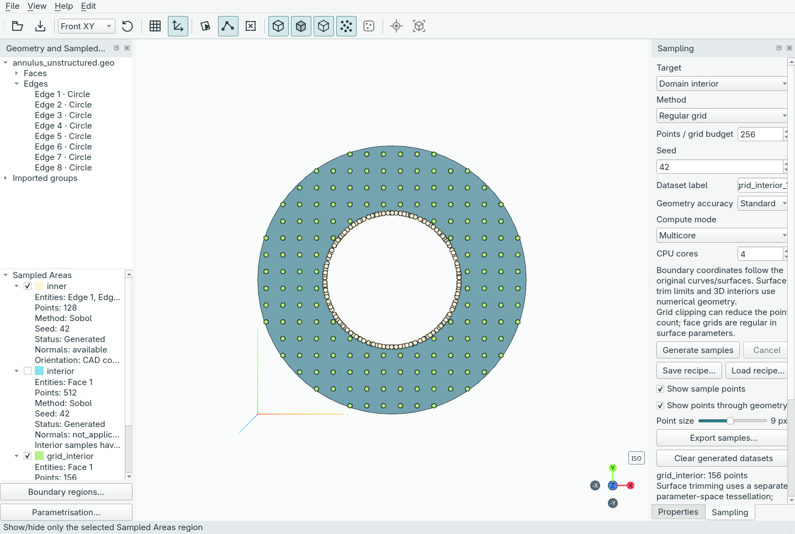
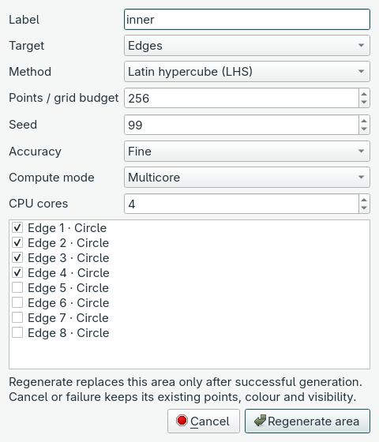

<!-- Generated by scripts/sync_docs.py from GUIDE.md; edit the source. -->

# Tutorial: Comparing sampling methods and editing areas

Choosing the right spatial distribution—and refining individual regional point
counts without rebuilding an entire workspace—is central to PINN and surrogate-model
experiments. This tutorial shows how to compare Jorvik's seven sampling algorithms
side by side, edit and regenerate an existing dataset in place with **Edit…**, and
use session **Undo / Redo**.

## 1. Compare structured grids against quasi-Monte Carlo sequences

Starting from the annulus workspace (`examples/geometries/cfdbench/annulus_unstructured.geo`)
with `inner` (128 Sobol boundary points) and `interior` (512 Sobol interior points):

1. In **Sampling**, keep **Target → Domain interior**, change **Method** to **Regular grid**, set **Points / grid budget** to **256**, enter `grid_interior`, and click **Generate samples**.
2. Uncheck `interior` in **Sampled Areas** so only `inner` and `grid_interior` are displayed, and set **Point size** to **9 px**.

Notice that `grid_interior` contains **148** points from the **256**-point budget:
**Regular grid** constructs a complete $16 \times 16$ Cartesian lattice across the
surface parameter bounding box and clips out candidates that fall inside the central
hole or outside the outer radius. By contrast, the six stochastic and quasi-random
methods always return the exact requested point count (`512`).

## 2. When to choose each of the seven sampling methods

| Method | Deterministic or Seeded | Exact Point Count | Best Suited For | Key Mathematical Property |
| --- | --- | --- | --- | --- |
| **Uniform random** | Seeded (`np.random.default_rng`) | Yes | Baseline Monte Carlo batches and quick previews | Independent and identically distributed unit-cube draws |
| **Regular grid** | Deterministic (seed unused) | Clipped to domain ($\le$ budget) | Structured parameter-space lattices and finite-difference comparisons | Complete Cartesian layers in curve/surface/bounding-box parameters |
| **Latin hypercube (LHS)** | Seeded (`scipy.stats.qmc.LatinHypercube`) | Yes | Ensuring every 1D marginal interval is represented | 1D marginal stratification in the unit candidate cube |
| **Sobol** | Seeded scrambled base-2 (`scipy.stats.qmc.Sobol`) | Yes (strongest at $2^k$ counts) | Low-discrepancy interior and boundary collocation points | Digital $(t, m, s)$-net balance in candidate space |
| **Halton** | Seeded scrambled (`scipy.stats.qmc.Halton`) | Yes | Low-discrepancy sampling at arbitrary non-power-of-two counts | Coprime radical-inverse bases across candidate dimensions |
| **Hammersley** | Seeded random shift + radical inverse | Yes | Fixed-size low-discrepancy point sets with uniform first axis | Equispaced $(i + 0.5)/N$ first coordinate paired with radical inverses |
| **Stratified** | Seeded recursive binary partition | Yes | Guaranteeing one sample per equal-volume candidate box | Recursive longest-axis split into $N$ equal-measure candidate strata |

## 3. Edit and regenerate an existing area in place

To change a dataset's method, point count, accuracy, or target entities without
deleting it and losing its colour, visibility, or transform bindings, right-click
`inner` in **Sampled Areas** and choose **Edit…**.

In the **Edit sampled area** dialog:

1. Change **Method** to **Latin hypercube (LHS)**.
2. Increase **Points / grid budget** to **256** and change **Seed** to **99**.
3. Switch **Accuracy** from **Standard** (`32`) to **Fine** (`64`).
4. Review the checked constituent entities (`Edge 1` through `Edge 4`), then click **Regenerate area**.

Replacement is atomic: while the background worker runs, the original 128-point
`inner` dataset remains in memory. If you cancel generation or if an error occurs,
the original points, label, and colour are preserved untouched. Once generation
succeeds, the updated 256-point cloud replaces `inner` in place and retains its
swatch colour and visibility state.

## 4. Duplicate datasets and navigate the 30-step Undo/Redo history

- **Duplicate without resampling**: Right-click any generated dataset and choose
  **Duplicate dataset** to create an instant copy (`inner_1`) that shares the
  underlying immutable coordinate and normal buffers while allowing independent
  renaming, colour changes, or region-scoped transform experiments.
- **Undo and Redo**: Choose **Edit → Undo** (`Ctrl+Z`) or **Edit → Redo**
  (`Ctrl+Shift+Z` / `Ctrl+Y`) to step backward and forward through the last 30
  workspace edits—including generation, in-place area regeneration, recipe loading,
  renaming, colour changes, dataset deletion, clearing, boundary-region edits, and
  saved transform setups—without re-running Gmsh.
