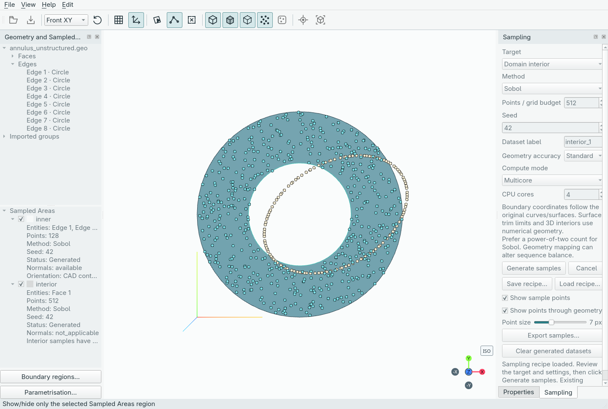
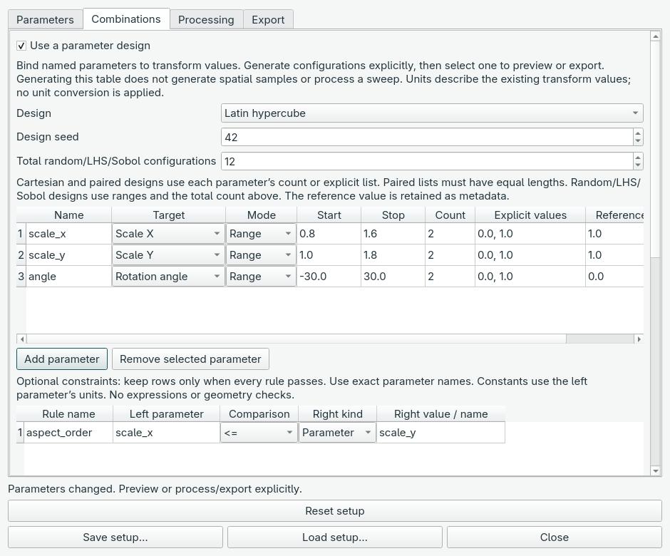

<!-- Generated by scripts/sync_docs.py from GUIDE.md; edit the source. -->

# Tutorial: LHS parameter sweeps and region augmentation

Beyond Cartesian grids of transformation values, Jorvik supports space-filling
**Latin hypercube (LHS)**, **Sobol**, and **Seeded random** parameter designs,
parameter-to-parameter inequality constraints, and selected-region augmentation.
This tutorial demonstrates those workflows in the **Parametrisation** workspace and
shows how to stream the exported sweep shards directly into a downstream PINN or
scientific machine learning training loop.

## 1. Compare whole-domain transforms with selected-region augmentation

With `inner` and `interior` generated on the annulus, click **Parametrisation…**
below **Sampled Areas**:

1. On the **Parameters** tab, change **Scope** from **Whole domain — consistent transformation**
   to **Selected regions — dataset augmentation**.
2. Check `inner` in **Affected regions** (leaving `interior` unchecked) and set
   **Translation X** to **0.35**.
3. Switch to **Processing** and click **Preview configuration**.



In **Selected regions** mode, only the checked point clouds move while the CAD
display and unchecked datasets stay fixed. Jorvik explicitly labels the resulting
export metadata with `domain_consistency: "unverified"` to distinguish dataset
augmentation from a physically consistent whole-domain affine transformation. Click
**Restore original view** and switch **Scope** back to **Whole domain — consistent transformation**.

## 2. Build a multi-parameter Latin hypercube (LHS) range design

Open the **Combinations** tab and check **Use a parameter design**:

1. Choose **Design → Latin hypercube**, set **Design seed** to **42**, and set
   **Total random/LHS/Sobol configurations** to **12**.
2. Click **Add parameter** three times and configure three continuous parameter ranges:

| Name | Target | Mode | Start | Stop | Reference | Unit |
| --- | --- | --- | --- | --- | --- | --- |
| `scale_x` | Scale X | Range | `0.8` | `1.6` | `1.0` | `dimensionless` |
| `scale_y` | Scale Y | Range | `1.0` | `1.8` | `1.0` | `dimensionless` |
| `angle` | Rotation angle | Range | `-30.0` | `30.0` | `0.0` | `degrees` |

## 3. Enforce parameter-to-parameter ordering constraints

Suppose your parametric study requires the Y scale factor to be at least as large
as the X scale factor ($s_x \le s_y$) across every configuration:

1. In the constraints table on **Combinations**, click **Add constraint**.
2. Enter **Rule name** `aspect_order`, **Left parameter** `scale_x`, **Comparison** `<=`,
   **Right kind** `Parameter`, and **Right value / name** `scale_y`.
3. Click **Generate configurations**.



Because `scale_x` and `scale_y` both use `dimensionless` units, Jorvik validates and
applies the parameter-to-parameter comparison across all 12 LHS candidates,
retaining accepted configurations with their original `configuration_000001`… IDs
and recording any excluded rows in **Rejected configurations…** without drawing
replacements.

## 4. Stream exported sweeps into a downstream PINN training loop

After exporting your design from **Processing → Export generated design…** to a
folder such as `parameter_sweep`, downstream training scripts can iterate through
verified configurations one shard at a time using `iter_sweep_datasets` and
`training_arrays`:

```python
import numpy as np
from jorvik.sweep_results import iter_sweep_datasets, training_arrays

for config in iter_sweep_datasets("parameter_sweep", require_integrity=True):
    # 1. Build (x, y, z, mu_1, ..., mu_P) input arrays per region label
    feature_names = ["x", "y", "z", *config["parameters"]]
    inputs = training_arrays(config)
    x_interior = inputs["interior"]  # shape: (N_int, 3 + P)
    x_inner = inputs["inner"]        # shape: (N_bnd, 3 + P)

    # 2. Retrieve transformed outward normals and entity tags from datasets
    by_label = {batch["label"]: batch for batch in config["datasets"]}
    n_inner = np.asarray(by_label["inner"]["normals"], dtype=np.float64)  # shape: (N_bnd, 3)
    tags_inner = np.asarray(by_label["inner"]["entity_tags"], dtype=np.int32)

    # 3. Pass (x_interior, x_inner, n_inner, tags_inner) to your PyTorch / JAX model
    assert x_inner.shape[0] == n_inner.shape[0]
```

Each shard's SHA-256 checksum, parameter provenance, and unit-length outward
normals (transformed via the inverse transpose and per-edge parent plane frames)
are verified automatically before `iter_sweep_datasets` yields the configuration.
