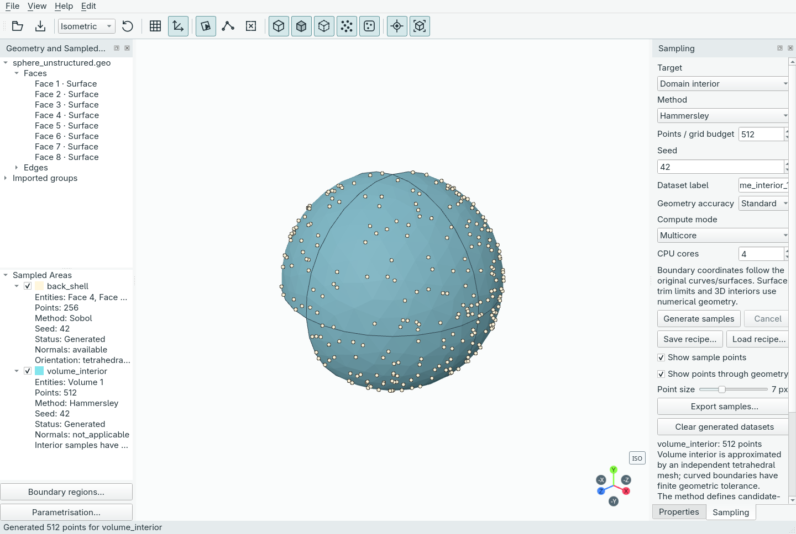
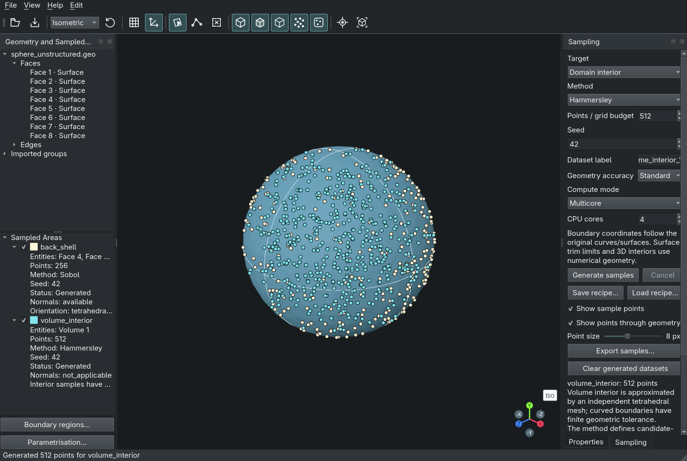
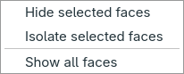

<!-- Generated by scripts/sync_docs.py from GUIDE.md; edit the source. -->

# Workspace and visibility

Drag with the left mouse button to orbit; right-drag to pan; scroll to zoom.
Use the camera selector or the bottom-right orientation gizmo for standard views.
The reference grid is hidden by default. Use Grid to show it in the XY plane
when needed. Grid and axes can be toggled independently.
Reset view returns to the default isometric camera; it fits the loaded geometry.

Left: Geometry and Sampled Areas. Right: Properties and Sampling. The left pane
contains independently scrollable geometry and sampled-area trees; drag their
divider to adjust their heights. Properties and Sampling scroll within their
panes when content grows. Selecting many entities keeps neighbouring panes
available. Properties text can be selected and copied. There is no bottom Results
pane; older saved layouts do not recreate it.
Use View to show/hide panes; drag their titles to rearrange or detach them.
View → Reset layout restores the initial layout. Window geometry, panel layout,
and theme persist between launches. Use File → Save project to preserve CAD, sampled datasets and workspace settings.

## Toolbar and visibility

The viewport tools use theme-aware icons and hover tooltips. Separators group
file operations, camera controls, grid/axes aids, selection, visibility and region
isolation. Open/export are also available in File; visibility actions have named
entries under View → Visibility. The camera orientation dropdown retains view
names so each direction remains explicit. Keyboard shortcuts remain available.

Geometry is the master visibility switch. Faces and Edges independently control
shading and wireframe; hiding Faces retains enabled edges. Hiding Geometry hides
both while remembering the separate Face/Edge choices. Hidden CAD entities cannot
be picked in the viewport; the geometry tree still allows their selection.
Visibility toggles do not clear the existing selection.

All samples mirrors Show sample points in Sampling. Selected region samples
mirrors the checkbox of the currently selected generated Sampled Areas label.
Both controls preserve the coordinates and export data.

Select a generated label and toggle Isolate region to filter the viewport to that
label's sample points. Isolation initially hides geometry; Geometry in isolation
optionally shows the region's faces and their boundary edges (or its sampled
edges). For domain-interior samples, the geometry context is the whole domain,
because interior generation currently targets all volumes. Global visibility
switches and region checkboxes still apply during isolation. Selecting another
generated label changes the isolation target. Turning isolation off restores the
normal visibility choices without changing them. Clearing datasets or replacing
the geometry exits isolation. These controls affect only display: geometry,
selection, sampling settings and generated coordinates are retained, and export
includes hidden and non-isolated datasets.

## Face and sampled-area context menus

Right-click a face in the geometry tree to hide the selected faces, isolate them,
or show all faces again. Right-clicking an unselected face selects it; right-clicking
one of several selected faces keeps the group. These controls affect shaded faces;
edges retain their separate visibility setting. Picking uses the nearest visible face at the cursor. Edge picking uses a fixed
six-pixel radius at every zoom level and tests occlusion at the candidate edge
point; an edge behind a visible face cannot be selected through it. The nearest
edge in screen distance wins, with camera depth breaking ties. Geometry outside
the camera clipping range is ineligible. Hidden faces cannot be picked in
3D, but remain available in the tree. Show all faces also restores the Geometry and
Faces switches and exits sampled-region isolation. Importing geometry clears face masks.

Right-click a Sampled Areas label (or its details) to rename it, change its colour,
show/hide its points, isolate it, or show all regions. Colour swatches match the point
clouds; defaults use warm white, cyan, lime, lavender and white. Changes take effect
immediately. Renaming requires a non-empty, unique label and is disabled during
generation. Hidden/isolation state and coordinates survive renaming. Exports use
the new labels and include each region's colour in its metadata. Canceling either
dialog leaves the region unchanged. These display choices are included when saving a project.
