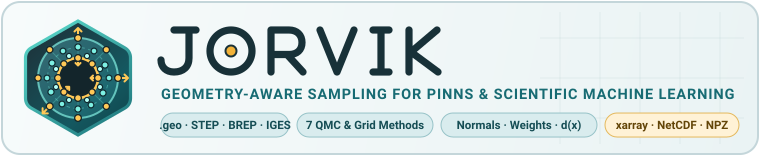
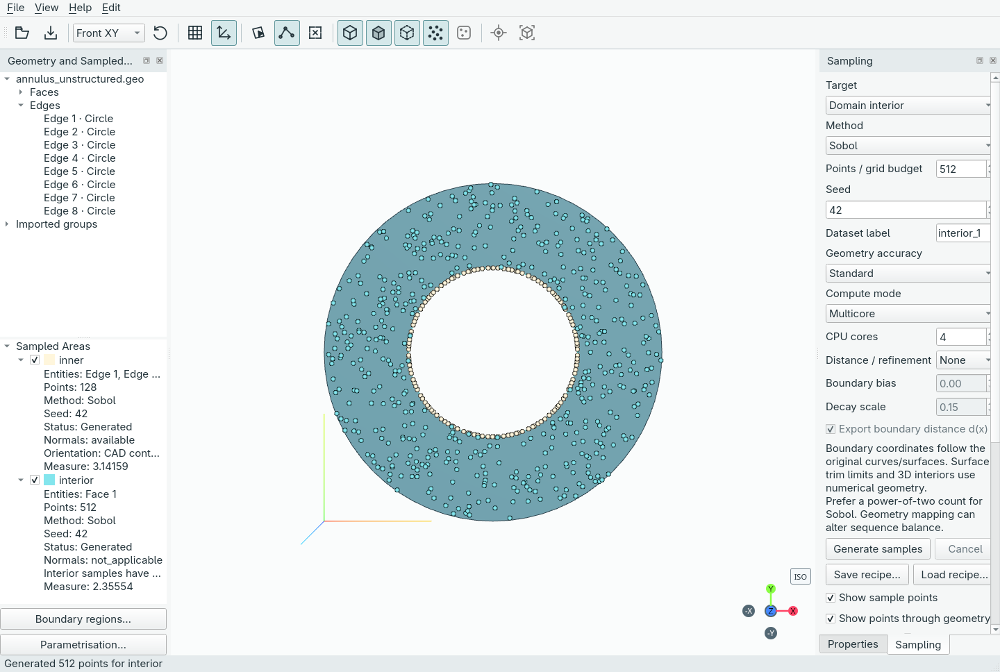

# Jorvik desktop application

  

Open prepared CAD, label boundary regions, and generate reproducible collocation
and boundary datasets in an interactive 3D desktop workspace. Jorvik preserves
the exact relationship between each sample point and its original CAD face, edge,
or interior subdomain—exporting coordinates, entity tags, orientation-verified
outward normals, per-point quadrature weights, and unsigned boundary distances
$d(\mathbf{x})$ directly into your scientific ML training pipeline.

**Development preview · 0.1.0.dev0**

[Start with your first dataset](guide/getting-started.md){ .md-button .md-button--primary }
[Quadrature weights, d(x) & CAD sweeps](guide/tutorial-advanced-pinn-workflows.md){ .md-button }

## One workflow, from CAD to training tensors

1. **Open geometry.** Import Gmsh `.geo` (built-in or Open CASCADE kernel), STEP (`.step`, `.stp`), Open CASCADE BREP (`.brep`), or IGES (`.iges`, `.igs`) with automatic STEP/IGES header unit detection.
2. **Name boundaries.** Group existing CAD faces or edges into colour-coded boundary regions without re-partitioning or modifying the CAD file.
3. **Generate & refine samples.** Choose among 7 spatial sampling methods, optionally concentrate density near reference walls using boundary-distance refinement $d(\mathbf{x})$, and compute per-point quadrature weights and verified outward normals.
4. **Sweep & export.** Preview affine transforms or `.geo` dimensional CAD regenerations, run checksum-verified background parameter sweeps, and export `xarray.Dataset` / `xarray.DataTree` NetCDF (`.nc`) or NumPy (`.npz`) bundles.

---

## Step-by-step illustrated tutorials

Follow the seven GUI tutorials in order, from your first 2D dataset to 3D neutral CAD solids, parametric LHS sweeps, boundary-layer refinement, and `.geo` dimensional CAD regeneration:

| # | Tutorial | What You Will Build |
| --- | --- | --- |
| **1** | [**Your first dataset in the GUI**](guide/getting-started.md) | Import the 2D CFDBench annulus, pick inner circular arcs, save a `Region: inner` boundary definition, generate boundary and interior Sobol point clouds, and save a lightweight `.jorvik` project copy. |
| **2** | [**3D sphere cutaway & volume sampling**](guide/tutorial-3d-sphere.md) | Pick 3D surface patches on a sphere, hide front faces to expose the hollow shell, mesh and sample the 3D tetrahedral interior with Hammersley points, isolate a region with CAD context, and switch to the dark theme. |
| **3** | [**STEP & BREP neutral CAD workflows**](guide/tutorial-cad-workflows.md) | Import 3D Open CASCADE `.brep` and `.step` solids, inspect containment-verified outward surface normals on curved cylinders, and see how open surface shells (`cube_filet.stp`) protect against guessed interiors or unverified normals. |
| **4** | [**Comparing methods & editing areas**](guide/tutorial-editing-and-comparison.md) | Compare structured parameter grids against low-discrepancy Sobol sequences side by side, edit and atomically regenerate an area in place with **Edit…**, duplicate datasets without resampling, and step through the 30-entry Undo/Redo history. |
| **5** | [**Transforms & Cartesian sweeps**](guide/transforms-and-sweeps.md) | Preview reversible `scale → rotate → translate` configurations, build a Cartesian parameter design with literal constraints, export a background sweep, resume an interrupted run, and verify SHA-256 shard checksums in the **Sweep Inspector**. |
| **6** | [**LHS sweeps, augmentation & PINNs**](guide/tutorial-parametric-lhs-and-augmentation.md) | Compare whole-domain transforms with selected-region augmentation, build a 3-parameter Latin hypercube (LHS) design with parameter-to-parameter ordering constraints ($s_x \le s_y$), and stream shards into a PINN training loop. |
| **7** | [**Quadrature weights, $d(\mathbf{x})$ refinement & CAD sweeps**](guide/tutorial-advanced-pinn-workflows.md) | Concentrate interior collocation points near a wall with exponential boundary-distance refinement, export importance-corrected quadrature weights and $d(\mathbf{x})$, sweep `.geo` feature dimensions (`Geo: r_in`), and load a consolidated `sweep_bundle.nc` into an `xarray.DataTree`. |

---

## Topic & reference guide

| Topic | Documentation Page |
| --- | --- |
| Navigate the 3D viewport, toolbar, face masks, and region isolation | [Workspace and visibility](guide/workspace.md) |
| Import `.geo`, STEP, BREP, and IGES files, detect units, and pick entities | [Geometry and selection](guide/geometry.md) |
| Assign arbitrary labels and colours to sets of CAD faces or edges | [Boundary regions](guide/regions.md) |
| Choose among the 7 sampling algorithms, accuracy levels, and JSON recipes | [Sampling and accuracy](guide/sampling.md) |
| Understand outward surface normals, planar co-normals, and unavailable states | [Outward normals](guide/normals.md) |
| Manage Sampled Areas, edit recipes in place, and use Undo/Redo | [Datasets and editing](guide/datasets.md) |
| Save `.jorvik` archives, lightweight recipe-only copies, and crash recovery | [Projects and recovery](guide/projects.md) |
| Understand affine matrices, Jacobian weight transport, and sweep schemas | [Transform schema and behaviour](guide/parametrisation.md) |
| Load coordinates, entity tags, normals, weights, $d(\mathbf{x})$, and DataTrees | [NetCDF, NPZ and xarray](reference/exports.md) |
| Automate headless sampling, recipes, transforms, and sweeps in Python | [Code recipes (advanced)](guide/recipes.md) |
| Install Jorvik, configure Linux/Wayland NVIDIA rendering, or run tests | [Installation](development/installation.md) · [Graphics](guide/graphics.md) · [Testing](development/testing.md) |

## Scope and current limits

Surface trims and 3D solid interiors use independent Gmsh numerical discretizations.
STEP and IGES files record their declared header coordinate units (`mm`, `m`, `in`, etc.);
`.geo` and `.brep` coordinate units remain unspecified. Outward normals are omitted
whenever orientation cannot be verified against a unique parent domain. Parametrisation
supports translation, rotation, positive scaling, `.geo` dimensional CAD regeneration,
per-point quadrature weights with exact affine Jacobian transport, unsigned boundary
distances, named parameter designs, consolidated `xarray.DataTree` sweep bundles,
and sequential background sweeps with SHA-256-verified training reads. See the
[roadmap](development/roadmap.md) and [release record](development/release.md) for
validated platforms and ongoing work.
