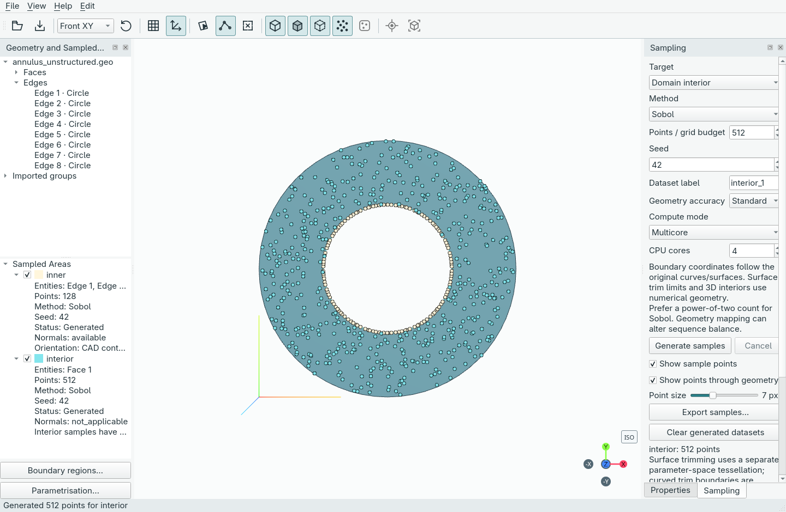

# Jorvik desktop application

Open CAD, name boundaries and generate points in an interactive desktop workspace.
Jorvik turns prepared geometry into reproducible, labelled datasets for
PINNs and scientific machine learning. Keep the relationship between each point
and its original face, edge or interior region, then bring the data into your own
training code.

**Development preview · 0.1.0.dev0**

[Start with your first dataset](guide/getting-started.md){ .md-button .md-button--primary }
[Preview transforms and export sweeps](guide/transforms-and-sweeps.md){ .md-button }

Everything shown here is done through the GUI. The guides below show what to
click, what each screen looks like, and how to save the result.

## One workflow, from CAD to arrays

1. **Open geometry.** Import Gmsh `.geo`, STEP, Open CASCADE BREP or IGES.
2. **Name boundaries.** Assign existing faces or edges to arbitrary regions.
3. **Generate samples.** Choose a method, point count, seed and geometry accuracy.
4. **Inspect and keep.** Preview several datasets, save the workspace and export
   independent coordinate arrays with entity tags and applicable outward normals.

CAD already contains the boundary partitions. Jorvik labels and samples them;
physics, prescribed boundary values and solvers belong in downstream tools.

## Find what you need

| Task | Read |
| --- | --- |
| Follow the app step by step, with screenshots | [Your first dataset in the GUI](guide/getting-started.md) |
| Preview transforms, export sweeps and verify results in the GUI | [Transforms and sweeps in the GUI](guide/transforms-and-sweeps.md) |
| Import CAD and select the right entity | [Geometry and selection](guide/geometry.md) |
| Label several faces or edges together | [Boundary regions](guide/regions.md) |
| Save/load reusable sampling settings | [Sampling recipes](guide/sampling.md#sampling-recipe-files) |
| Choose a sampling method and accuracy | [Sampling and accuracy](guide/sampling.md) |
| Understand outward directions and unavailable normals | [Boundary normals](guide/normals.md) |
| Save CAD and recipes without large point clouds | [Lightweight project copies](guide/projects.md#save-a-lightweight-copy-without-points) |
| Save work or recover an interrupted session | [Projects and recovery](guide/projects.md) |
| Automate integration or copy Python examples | [Code recipes (advanced)](guide/recipes.md) |
| Install this development preview | [Installation and launch](development/installation.md) |
| Load training arrays in Python | [NetCDF, NPZ and xarray](reference/exports.md) |
| Run a complete annulus example | [Release checks and example](development/release.md) |
| Contribute or verify a change | [Architecture](development/architecture.md) · [Testing](development/testing.md) |

## Know the current limits

Surface trims and solid interiors use numerical geometry checks. Units are
currently unspecified, and arbitrary industrial CAD still needs validation.
Normals are omitted when outward orientation cannot be verified. Parametrisation
supports translation, rotation, positive scaling, named parameter designs and
sequential background sweeps with checksum-verified training reads. Affine maps
do not regenerate CAD, resample points or provide integration weights.

Local installation checks cover macOS arm64/Python 3.12 and Linux/Wayland with
Python 3.12 and 3.14. Broader CAD compatibility, Windows checks and further
large-project memory improvements remain on the [roadmap](development/roadmap.md). See the detailed
[release record](development/release.md) before relying on a new workflow.
